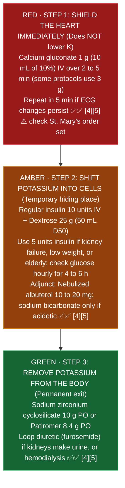
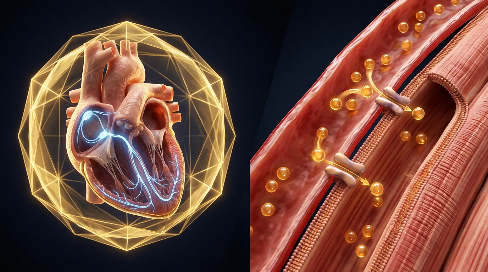

# Adult Critical Care: Pharmacist Core (Module 9)

**Pharmacist's job overnight in the ICU:** pressors and drips right, analgesia before sedation, electrolytes corrected at a safe speed, glucose in range without lows, and nothing given that keeps a patient on the ventilator longer than needed.
**Key:** ✅✅ two independent sources · ✅ one source · ⚠️ [VERIFY]

Related: [[Norepinephrine]] · [[Insulin_IV_DKA]] · [[Potassium_Chloride_IV]] · [[ID_Core]] (sepsis) · [[IV_Compatibility]] · [[Codes_Resuscitation]]

---

## 1. Shock and pressors (SSC 2021)
- Norepinephrine first; add vasopressin instead of raising norepinephrine; then epinephrine; dobutamine for heart dysfunction ✅ [1] · [[Norepinephrine]].
- MAP goal 65 ✅ [[Norepinephrine]].
- Steroids when norepinephrine or epinephrine is 0.25 mcg/kg/min or more for at least 4 h ✅ [1]; hydrocortisone 200 mg/day (50 mg IV every 6 h or a continuous infusion) ✅✅ [iatroX: steroids in refractory septic shock (SSC 2021)](https://www.iatrox.com/q/6a080366ba841a69964a57e8/steroid-use-in-refractory-septic-shock); [The Bottom Line: steroids in sepsis](https://www.thebottomline.org.uk/blog/steroids-in-sepsis/).

## 2. Pain, sedation and delirium (PADIS 2018)
| Topic | Recommendation | Check |
|---|---|---|
| Order of care | Analgesia first, then sedation | ✅ [2] |
| Target | Light sedation for most patients (RASS or SAS) | ✅ [2] |
| Sedative | Propofol or dexmedetomidine over benzodiazepines; no preference between the two ⚠️; deep sedation (paralysis) usually propofol | ✅ [2] |
| Pain tools | CPOT or BPS when the patient can't report pain | ✅ [2] |
| Pain adjuncts | Acetaminophen; low dose ketamine after abdominal surgery; gabapentin or pregabalin for neuropathic pain; no routine IV lidocaine or NSAIDs | ✅ [2] |
| Delirium | Screen with CAM-ICU or ICDSC; don't give drugs to prevent it; no routine antipsychotics; dexmedetomidine when agitation is blocking extubation | ✅ [2] |
| Sleep | No melatonin recommendation; don't use propofol for sleep | ✅ [2] |

**Propofol infusion syndrome (PRIS):** risk rises above 4 mg/kg/h (about 67 mcg/kg/min) and after 48 h, plus catecholamines or steroids. Signs: metabolic acidosis, bradycardia, rhabdomyolysis, high triglycerides, AKI. Stop propofol ✅ [3]. Monitor triglycerides and CK on longer infusions; count propofol's lipid calories (about 1.1 kcal/mL) in nutrition ⚠️ [VERIFY label].
- **Why PRIS happens in the body:** At high doses over 48 hours, propofol blocks mitochondria from burning fatty acids for energy. Starved heart and skeletal muscle cells break down (rhabdomyolysis, lactic acidosis, bradycardia), and unburned fat piles up in the blood (high triglycerides) ✅ [3].

## 3. Hyperkalemia
| Step | Drug and dose | Check |
|---|---|---|
| Protect the heart | Calcium gluconate 1 g (10 mL of 10%) IV over 2 to 5 min; repeat in 5 min if ECG changes persist | ✅✅ [4][5] |
| Shift | Regular insulin 10 units IV with dextrose 25 g (50 mL D50); **5 units** if high hypoglycemia risk (kidney failure, low weight, elderly); check glucose hourly for 4 to 6 h | ✅✅ [4][5] |
| Shift (adjunct) | Nebulized albuterol 10 to 20 mg; sodium bicarbonate only if acidotic | ✅ [4] |
| Remove | Sodium zirconium cyclosilicate 10 g or patiromer 8.4 g; loop diuretic if kidneys work; dialysis | ✅✅ [4][5] |

KDIGO severity: severe = K above 6.5, or 6.1 to 6.5 with ECG changes ✅ [5].

### Hyperkalemia 3 step rescue ladder (Protect, Shift, Remove)

*Sources: Emergency Care BC [4]; Munson Healthcare Adult Acute Hyperkalemia Reference / KDIGO [5] ✅✅*

**How hyperkalemia treatment works and timing in the body (plain English):**
- **Step 1 (Calcium gluconate, works in 1 to 3 minutes, lasts 30 to 60 minutes):** High blood potassium makes heart muscle trigger happy and ready to fibrillate. Calcium does **not** change the potassium number on the lab test at all; it raises the electrical firing threshold of heart cells so the heart does not arrest while you wait for Step 2 to work ✅✅ [4][5].
- **Step 2 (IV regular insulin + dextrose, starts in 15 to 30 minutes, lasts 4 to 6 hours):** Insulin turns on the sodium potassium pump and hides potassium inside muscle cells (dropping serum K by about 0.5 to 1.2 mEq/L). In kidney failure, kidneys cannot clear insulin, so insulin stays in the blood much longer than dextrose (1 hour) and causes late hypoglycemia 3 to 6 hours later. That is why kidney failure patients get **5 units** of insulin instead of 10 units and get hourly glucose checks for 4 to 6 hours ✅✅ [4][5].
- **Step 3 (Binders, diuretics, dialysis):** Because insulin only hides potassium inside cells temporarily, potassium will leak right back out into the blood unless you actually remove it in the stool (binders) or urine/dialysis ✅✅ [4][5].

## 4. Hyponatremia
- **Severe symptoms (seizure, coma):** 3% saline **bolus** 150 mL over 20 min, repeat if needed; aim for about a 5 mmol/L rise in the first hour ✅ [6]. US practice: 100 to 150 mL of 3% over 10 to 20 min, repeat up to 3 times; 100 mL raises Na about 2 to 3 mmol/L; first goal a 4 to 6 rise ✅✅ [6] · [ACEP: severe hyponatremia](https://acep.org/criticalcare/newsroom/newsroom-articles/september2022/the-resuscitationists-approach-to-severe-hyponatremia).
- **Limits:** 10 mmol/L in the first 24 h, then 8 per 24 h (European) ✅✅ [6][7]. **High risk** (alcohol use disorder, low potassium, malnutrition, liver disease): 8 per 24 h max ✅ [7].
- **Overcorrection:** stop hypertonic fluid; hypotonic fluid with or without desmopressin ✅ [6].
- **Debate:** newer data (MacMillan 2023) suggest osmotic demyelination is rare and slow correction has its own risks; follow St. Mary's protocol ✅ [7].
- **Why the 8 to 10 mmol/L per 24 hour speed limit exists (plain English):** Water always follows salt. When blood sodium is low, water moves into brain cells and makes them swell (causing seizures). If you dump too much salt into the blood too fast, water gets sucked violently out of brain cells, shrinking them and ripping off their protective nerve insulation (osmotic demyelination syndrome). Raising sodium by **4 to 6 mmol/L** in the first hour stops the seizure safely, and staying under **8 to 10 mmol/L per 24 hours** protects the brain's myelin insulation ✅✅ [6][7].

## 5. ICU glucose
- Start an insulin infusion above 180 mg/dL; target **140 to 180 mg/dL** (ADA, AACE) ✅✅ [8][9].
- NICE-SUGAR: tight control (81 to 108) raised 90 day death (27.5% vs 24.9%) and severe lows (6.8% vs 0.5%) ✅ [9].
- DKA is its own protocol: [[Insulin_IV_DKA]].

## 6. Other daily ICU checks
- **Updated 2026-10-17.** Before: "ventilation over 48 h, coagulopathy." After: stress ulcer prophylaxis for **coagulopathy, shock or chronic liver disease** (SCCM/ASHP 2024); mechanical ventilation alone is not an established indication; not for low risk patients on tube feeds; PPI or H2 blocker; stop when the risk resolves or at ICU transfer ✅✅ [SCCM/ASHP 2024 stress ulcer prophylaxis guideline](https://www.sccm.org/clinical-resources/guidelines/guidelines/sccm-ashp-guideline-prevention-of-ugib); [HelixTalk 185: 2024 SUP guideline](https://www.rosalindfranklin.edu/academics/college-of-pharmacy/helixtalk/helixtalk-185-they-are-late-but-don-t-stress-the-new-2024-stress-ulcer-prophylaxis-guidelines).
- VTE prophylaxis unless bleeding; trauma uses enoxaparin per [[Trauma_Core]].
- Drips through compatible lines ([[IV_Compatibility]]); concentrated drips central.
- Renal dosing as CrCl changes; augmented clearance in young trauma patients ⚠️ [VERIFY].

## Sources
1. [Evans L, et al. Surviving Sepsis Campaign 2021. Crit Care Med 2021;49:e1063-e1143](https://doi.org/10.1097/CCM.0000000000005337) · summary: [UIC Drug Information Group: SSC 2021 updates](https://dig.pharmacy.uic.edu/faqs/2022-2/march-2022-faqs/update-what-are-the-2021-pharmacotherapy-updates-to-the-surviving-sepsis-campaign-international-guidelines-for-management-of-sepsis-and-septic-shock)
2. [Devlin JW, et al. PADIS guideline. Crit Care Med 2018;46:e825-e873](https://doi.org/10.1097/CCM.0000000000003299) · summary: [US Pharmacist: PAD guideline updates for pharmacists](https://www.uspharmacist.com/article/pain-agitation-and-delirium-a-review-of-pertinent-guideline-updates-for-pharmacists) · [SCCM PADIS page](https://sccm.org/clinical-resources/guidelines/guidelines/focused-update-padis-guideline)
3. [Kam PCA, Cardone D. Propofol infusion syndrome. Anaesthesia 2007;62:690-701](https://doi.org/10.1111/j.1365-2044.2007.05055.x) · summary: [WikEM: Propofol infusion syndrome](https://wikem.org/wiki/Propofol_infusion_syndrome)
4. [Clase CM, et al. Potassium homeostasis and management of dyskalemia (KDIGO conference). Kidney Int 2020;97:42-61](https://doi.org/10.1016/j.kint.2019.09.018) · summary: [Emergency Care BC: Hyperkalemia](https://emergencycarebc.ca/clinical_resource/clinical-summary/hyperkalemia-diagnosis-and-treatment)
5. [Munson Healthcare: Adult acute hyperkalemia reference](https://www.munsonhealthcare.org/media/file/Physician%20Services/Clinical%20Resources/Adult%20Acute%20Hyperkalemia%20Management%20Reference%20Text.pdf)
6. [Society for Endocrinology: Emergency management of severe hyponatraemia (2022)](https://www.endocrinology.org/media/xhrhxhxm/emergency-management-of-severe-and-moderately-severely-symptomatic-hyponatraemia-in-adult-patients-2022.pdf)
7. [MacMillan TE, et al. Osmotic demyelination syndrome in patients hospitalized with hyponatremia. NEJM Evid 2023](https://doi.org/10.1056/EVIDoa2200215) · summary: [AJKD blog: NephMadness 2024 hyponatremia correction](https://ajkdblog.org/2024/03/01/nephmadness-2024-hyponatremia-region/)
8. [AACE: IV insulin hospital protocol](https://pro.aace.com/pdfs/diabetes/IV-Insulin-Hospital-Protocol-FINAL-090320.pdf)
9. [NICE-SUGAR Study Investigators. Intensive vs conventional glucose control in critically ill patients. N Engl J Med 2009;360:1283-1297](https://doi.org/10.1056/NEJMoa0810625) · summary: [WikiJournalClub: NICE-SUGAR](https://www.wikijournalclub.org/wiki/NICE-SUGAR)

## Verify locally at St. Mary's
- ICU vasopressor standard concentrations and central vs peripheral line policy.
- Adult hyperkalemia order set (insulin dose in renal impairment, potassium binder on formulary).
- 3% hypertonic saline storage and central vs peripheral bolus policy for severe hyponatremia.
- ICU insulin infusion calculator or column protocol.

*Last verified: 2026-10-17.*
