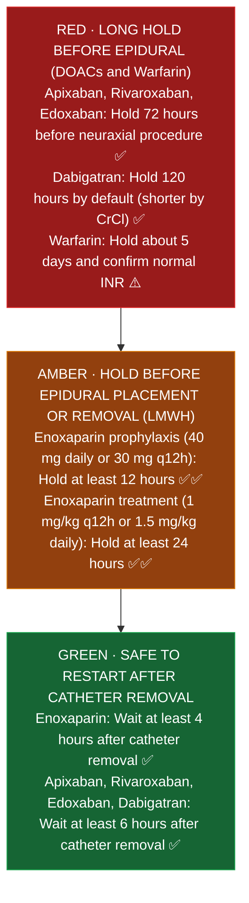

# Anticoagulation: Pharmacist Core (Module 7)

**Pharmacist's job:** right drug, right dose for kidney function and weight, right monitoring, no duplicate anticoagulants, safe timing around procedures and epidurals, and fast reversal.
**Key:** ✅✅ two independent sources · ✅ one source · ⚠️ [VERIFY]

Drug pages: [[Heparin]] · [[Enoxaparin]] · [[4F_PCC]]. Reversal table: [[Stroke_Core]] section 3.

---

## 1. DOAC dosing (the numbers you verify every shift)
| Drug | Atrial fibrillation | VTE treatment | Kidney and other adjustments | Check | Sources |
|---|---|---|---|---|---|
| **Apixaban** | 5 mg BID | 10 mg BID x 7 days, then 5 mg BID; after at least 6 months of treatment, 2.5 mg BID to reduce recurrence (no set stop date; reassess at least yearly, CHEST 2021 [15]; AMPLIFY-EXT [16]; RENOVE [17]) | AF: 2.5 mg BID if **2 of 3**: age 80 or older, weight 60 kg or less, SCr 1.5 or higher | ✅✅ | [1] SmPC; [9] Pfizer label (India). Dialysis: NVAF trials excluded dialysis; VTE needs no renal adjustment per [9] ⚠️ [VERIFY US label wording] |
| **Rivaroxaban** | 20 mg daily **with the evening meal**; 15 mg if CrCl 15 to 50 | 15 mg BID with food x 21 days, then 20 mg daily with food | 15 and 20 mg tablets must be taken with food | ✅✅ | [2] EBM Consult monograph (US label); [3] GlobalRPh renal page (avoid if CrCl below 15 in AF, below 30 in VTE) |
| **Dabigatran** | 150 mg BID; 75 mg BID if CrCl 15 to 30 | After 5 to 10 days of parenteral therapy, 150 mg BID ⚠️ | Swallow capsules whole (opening raises exposure); P-gp interactions with renal impairment | ✅ (AF) | [4] FDA label (2012 version) |
| **Edoxaban** | 60 mg daily; 30 mg if CrCl 15 to 50; **don't use in AF if CrCl above 95** (less effective) | After 5 to 10 days parenteral; 60 mg daily (30 mg if CrCl 15 to 50, weight 60 kg or less, or certain P-gp inhibitors) | With or without food; tablets may be crushed | ✅ | [13] Drugs.com label summary; [14] label PDF (HemOnc) to recheck |

**Classic catches:** rivaroxaban 15 or 20 mg without food; apixaban reduced to 2.5 mg with only one criterion; DOAC plus a heparin product at the same time; DOAC in a prosthetic or mechanical heart valve (not recommended per label) ✅ [9]; strong CYP3A4 and P-gp inducers or inhibitors.

**How DOACs work and why their weird rules exist (plain English):**
- **Apixaban 2 of 3 rule (Age 80 or older, Weight 60 kg or less, SCr 1.5 or higher):** Apixaban blocks Factor Xa directly. Having only 1 of the 3 risk factors does not raise drug levels enough to justify cutting the dose in half, and underdosing leaves the patient unprotected against a stroke in atrial fibrillation. You only reduce to **2.5 mg BID** when **at least 2 of the 3** are present ✅✅ [1][9].
- **Why rivaroxaban 15 mg and 20 mg must be taken with food:** At the 15 mg and 20 mg strengths, an empty stomach absorbs only about two thirds of the tablet (66% bioavailability); taking it with food slows stomach emptying so nearly 100% is absorbed ✅ [2].
- **Why dabigatran capsules can NEVER be opened, crushed, or put down a feeding tube:** Dabigatran comes inside a special tartaric acid pellet shell designed to slow absorption. Opening the capsule and sprinkling the pellets increases drug absorption into the blood by **75%**, turning a normal dose into an overdose that causes severe bleeding ✅ [4].
- **Why edoxaban is avoided in atrial fibrillation when CrCl is above 95 mL/min:** About half of edoxaban is cleared by the kidneys; healthy kidneys clearing above 95 mL/min wash the drug out so fast that blood levels drop too low to prevent strokes ✅ [13][14].

**Extended VTE treatment (after the first 3 to 6 months):** for unprovoked VTE or a persistent risk factor, CHEST 2021 suggests reduced dose apixaban 2.5 mg BID or rivaroxaban 10 mg daily over full dose, with no predefined stop date and a review at least yearly; not for VTE provoked by a major transient risk factor such as surgery ✅ [15]. AMPLIFY-EXT: recurrent VTE 1.7% (2.5 mg) vs 8.8% (placebo) over 12 months ✅ [16]. RENOVE: recurrence 2.2% reduced vs 1.8% full dose (noninferiority not met), clinically relevant bleeding 9.9% vs 15.2% ✅ [17].

## 2. Warfarin
- **Supratherapeutic INR, no bleeding:** INR 4.5 to 10: hold doses; oral vitamin K is usually not needed (Crowther, Ann Intern Med 2009: vitamin K 1.25 mg did not reduce bleeding vs placebo) ✅✅ [5][6]. INR above 10: hold and give oral vitamin K 2.5 to 5 mg ✅ [6].
- **Major bleeding:** hold warfarin, vitamin K 10 mg IV, plus 4F-PCC by INR ✅✅ [6][[4F_PCC]].
- Route: oral for non urgent reversal; IV when faster reversal is needed; avoid IM; avoid high doses (5 to 10 mg) without bleeding because they cause warfarin resistance ✅ [6].
- Interactions to catch: antibiotics (TMP SMX, fluoroquinolones, metronidazole, fluconazole), amiodarone, rifampin; new diet or illness.

**How warfarin reversal works in the body (why you give 4F-PCC + vitamin K together):**
- **The relay race in the liver:** Warfarin stops the liver from using vitamin K to build clotting Factors II, VII, IX, and X (plus Proteins C and S).
- **4F-PCC is the instant borrowed army (works in 15 to 30 minutes, wears off in 12 to 24 hours):** 4F-PCC puts pre made human clotting Factors II, VII, IX, and X directly into the vein so bleeding stops right now, but those borrowed factors start wearing off after 12 to 24 hours ✅✅ [6][[4F_PCC]].
- **Vitamin K 10 mg IV restarts the patient's own factory (takes 6 to 24 hours to take over):** Warfarin stays in the body for days (half life 20 to 60 hours). If you give 4F-PCC without vitamin K, the INR rebounds right back up once the 4F-PCC wears off ✅✅ [6][[4F_PCC]].

## 3. Around procedures (CHEST 2022 and PAUSE)
- **Warfarin:** stop about 5 days before ✅✅ [7] (BRIDGE protocol); [8] UConn handout.
- **Bridging:** CHEST 2022 recommends **against** bridging in AF (strong) and suggests against it for mechanical valves or VTE (conditional) ✅ [10]. BRIDGE trial: no bridging was noninferior for clots and caused less major bleeding (1.3% vs 3.2%) ✅ [7]. Very high risk patients (for example a mechanical mitral valve or a clot in the last 3 months) are often still bridged per cardiology or hematology ✅ [8] ⚠️ [VERIFY St. Mary's policy].
- **DOACs:** stop 1 to 2 days before (dabigatran 1 to 4 days, longer if CrCl below 50); resume about 24 h after low or moderate bleed risk procedures, 48 to 72 h after high bleed risk ✅✅ [10][11] PAUSE. No bridging for DOACs ✅✅ [8][11].
- **PAUSE schedule (apixaban, rivaroxaban; dabigatran with CrCl 50 or higher):** low bleed risk: skip the day before and the day of surgery; high bleed risk: skip 2 days before and the day of ✅ [11].
- **Aspirin:** generally continue for elective noncardiac surgery ✅ [10].

## 4. Epidural and spinal timing (ASRA)
| Drug | Stop before neuraxial | Restart after catheter removal | Check | Sources |
|---|---|---|---|---|
| Enoxaparin prophylaxis | 12 h | 4 h (label) | ✅✅ | [[Enoxaparin]] |
| Enoxaparin treatment dose | 24 h | | ✅✅ | [[Enoxaparin]] |
| Apixaban, rivaroxaban, edoxaban | 72 h | 6 h | ✅ | [12] NYSORA summary of ASRA 2021 |
| Dabigatran | 120 h by default (shorter by CrCl) | 6 h | ✅ | [12] |
| Warfarin | Normal INR (usually about 5 days off) | | ⚠️ | [VERIFY ASRA current edition] |

### Epidural and spinal catheter timing ladder (ASRA)

*Sources: FDA Lovenox label [1]; ASRA Neuraxial Guideline summary via NYSORA [12] ✅✅*

**Why pulling an epidural catheter is just as dangerous as placing it:** Pulling an epidural tube out of the spine scrapes tiny veins inside the tight bony spinal canal. If a blood thinner is active when the nurse pulls the catheter out, blood pools inside that closed bony space (spinal epidural hematoma) and crushes the spinal cord, causing permanent paralysis. Always hold the blood thinner before **both** placement and removal ✅✅ [[Enoxaparin]][12].

## 5. Pharmacist verification checklist
1. Indication and the right dose for it.
2. CrCl (Cockcroft Gault, actual weight unless protocol says otherwise), weight, age, platelets, hemoglobin.
3. Only one anticoagulant active (check heparin flushes and SC prophylaxis too).
4. Interactions (CYP3A4 and P-gp; warfarin antibiotics).
5. Procedure or epidural coming? Hold times.
6. Reversal plan known for this drug.

## Sources
1. [Eliquis SmPC (UK electronic medicines compendium)](https://www.medicines.org.uk/emc/product/2878/smpc)
2. [EBM Consult: Rivaroxaban monograph](https://www.ebmconsult.com/articles/monograph-rivaroxaban-xarelto)
3. [GlobalRPh: Rivaroxaban renal dosing](https://globalrph.com/renal/rivaroxaban-xarelto/)
4. [Pradaxa label (2012, via HemOnc)](https://hemonc.org/docs/packageinsert/dabigatran.pdf)
5. [UMEM pearl on Crowther 2009, Ann Intern Med 150:293](https://stg.umem.org/t4/educational_pearls/?id=1762)
6. [Sunnybrook: Reversal of warfarin over anticoagulation, focus on vitamin K](https://sunnybrook.ca/uploads/Reversal_of_Warfarin_Over-Anitcoagulation_-_Focus_on_Vitamin_K.pdf)
7. [Pharmacy Times: Anticoagulation bridgegate (BRIDGE trial)](https://www.pharmacytimes.com/view/anticoagulation-bridgegate)
8. [UConn: Perioperative management handout](https://pharmacy.uconn.edu/wp-content/uploads/sites/2740/2020/02/Handouts-Perioperative-Management.pdf)
9. [Eliquis label (Pfizer)](https://labeling.pfizer.com/ShowLabeling.aspx?id=14028)
10. [CHEST 2022 perioperative guideline press release](https://chestnet.org/Newsroom/Press-Releases/2022/08/CHEST-releases-clinical-practice-guideline-on-perioperative-management-of-antithrombotic-therapy) · [Full guideline](https://journal.chestnet.org/article/S0012-3692%2822%2901359-9/fulltext)
11. [WikiJournalClub: PAUSE (Douketis, JAMA Intern Med 2019)](https://www.wikijournalclub.org/wiki/PAUSE)
12. [NYSORA: Regional anesthesia in anticoagulated patients](https://www.nysora.com/regional-anesthesia-in-anticoagulated-patients)
13. [Drugs.com: Savaysa dosage](https://www.drugs.com/dosage/savaysa.html)
14. [Edoxaban label PDF (HemOnc)](https://hemonc.org/w/images/archive/9/96/20211231232858%21Edoxaban.pdf)
15. [InpharmD: CHEST 2021 VTE guideline updates (extended phase, no predefined stop date, reassess yearly)](https://inpharmd.com/inquiries/07f4986748090377e7b55453247537ee1548098c5fee0b697ecb39673dbfddf8)
16. [WikiJournalClub: AMPLIFY-EXT (NEJM 2013, 12 months of extended apixaban)](https://www.wikijournalclub.org/wiki/AMPLIFY-EXT)
17. [The Hospitalist: RENOVE (Lancet 2025, reduced vs full dose extended DOAC)](https://www.the-hospitalist.org/hospitalist/article/39034/circulatory/evidence-for-reduced-dose-doac-in-those-at-high-risk-for-vte-recurrence-in-extended-phase-anticoagulation-the-renove-trial/)

## Verify locally at St. Mary's
- Pharmacy to dose anticoagulation policy (warfarin, heparin, enoxaparin, argatroban).
- Anticoagulant reversal order set (4F-PCC fixed vs weight based dosing for Factor Xa inhibitors).
- Anesthesia neuraxial hold protocol and EHR hard stops when an epidural catheter is in place.

*Last verified: 2026-10-17.*
