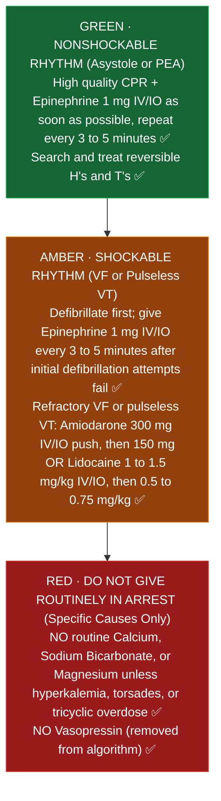

# Codes and Resuscitation: Pharmacist Core

**Pharmacist's job at a code:** know the crash cart, prepare and hand off the right dose, call out timing (epinephrine every 3 to 5 minutes), suggest reversible causes and their drugs, set up post arrest drips, and document.

Sources: AHA Guidelines for CPR and ECC (2025; adult ALS, PALS Part 8, NRP Part 5); AHA 2023 focused update on adult ACLS (toxicology and drug use); ASRA local anesthetic systemic toxicity checklist; MHAUS (malignant hyperthermia). Pediatric doses: [[PICU_Core]]. Neonatal doses: [[NICU_Core]].

---

## 1. Adult cardiac arrest drugs (AHA 2025: no major drug changes)
| Drug | Dose | When |
|---|---|---|
| Epinephrine | 1 mg IV/IO every 3 to 5 minutes | Nonshockable: as soon as possible. Shockable: after initial defibrillation attempts fail |
| Amiodarone | 300 mg IV/IO push, then 150 mg | Refractory VF or pulseless VT |
| Lidocaine | 1 to 1.5 mg/kg, then 0.5 to 0.75 mg/kg | Alternative to amiodarone |
| Vasopressin | Not in the 2025 algorithm | Epinephrine is the only vasopressor in the arrest algorithm |
| Calcium, bicarbonate, magnesium | Not routine | Only for specific causes (below) |

IV is preferred for drug delivery; IO if IV can't be placed quickly (AHA 2025).

### Adult cardiac arrest drug sequence ladder (AHA 2025)

*Sources: AHA Guidelines for CPR and ECC (2025); AHA 2023 Toxicology Focused Update ✅✅*

## 2. Reversible causes and the drug you hand them (H's and T's)
| Cause | Drug |
|---|---|
| Hyperkalemia | Calcium chloride 1 g IV (or calcium gluconate 3 g), insulin regular 10 units IV + dextrose 25 g, sodium bicarbonate 50 mEq if acidotic |
| Hypoglycemia | Dextrose 50% 25 g (50 mL) |
| Torsades / hypomagnesemia | Magnesium sulfate 1 to 2 g IV push in arrest |
| Opioid overdose | Naloxone 0.4 to 2 mg IV, or 4 mg intranasal; ventilation comes first in arrest |
| Tricyclic overdose (wide QRS) | Sodium bicarbonate 1 to 2 mEq/kg |
| Local anesthetic toxicity | Lipid emulsion 20%: 1.5 mL/kg bolus over 2 to 3 minutes, then 0.25 mL/kg/min (ASRA). Use smaller epinephrine doses (1 mcg/kg or less) |
| Pulmonary embolism | Alteplase 50 mg IV bolus can be considered in suspected PE arrest [VERIFY institutional protocol] |
| Beta blocker or calcium channel blocker overdose | High dose insulin, calcium, glucagon (beta blocker), vasopressors |

## 3. Peri arrest
- **Bradycardia:** atropine 1 mg IV every 3 to 5 minutes (max 3 mg); if no response, epinephrine infusion 2 to 10 mcg/min or dopamine 5 to 20 mcg/kg/min, or pacing.
- **Stable SVT:** adenosine 6 mg rapid push, then 12 mg (use 3 mg if central line, heart transplant, or patient on dipyridamole or carbamazepine; caffeine and theophylline reduce effect).
- **Anaphylaxis:** epinephrine 0.5 mg IM (1 mg/mL) in the thigh, repeat every 5 to 15 minutes; refractory: epinephrine infusion.
- **Malignant hyperthermia (after succinylcholine or volatile anesthetic):** dantrolene 2.5 mg/kg IV, repeat to effect (MHAUS). Know where the MH cart is and which product (Ryanodex reconstitutes much faster than Dantrium).

**How code drugs work and timing in the body (plain English):**
- **Why adenosine must be pushed in 1 second with an immediate flush (half life under 10 seconds):** Red blood cells and blood vessel walls destroy adenosine in **less than 10 seconds**. If you push it slowly or without a fast saline chase, it gets destroyed in the arm vein before it ever reaches the heart. Conversely, if the patient has a **central line** (which dumps straight into the heart), dipyridamole (which blocks adenosine breakdown), or a **transplanted heart** (denervated receptors are hypersensitive), standard 6 mg hits too hard and causes prolonged heart block, so you cut the first dose in half to **3 mg** ✅.
- **Why 20% lipid emulsion saves a life in local anesthetic toxicity (the lipid sink):** Local anesthetics (like bupivacaine) are fat soluble drugs that lock onto heart sodium channels and stop the heart. Infusing **20% lipid emulsion** creates a "fat sponge" in the bloodstream that pulls the fat soluble anesthetic out of heart tissue and shuttles it safely to the liver and muscle (ASRA) ✅.
- **Why sodium bicarbonate narrows a wide QRS in tricyclic antidepressant overdose:** Tricyclic overdoses block fast sodium channels on the heart. Giving **sodium bicarbonate 1 to 2 mEq/kg IV** does two things at once: the high load of sodium pushes past the blocked sodium channels, and raising blood pH (alkalinization) pulls the tricyclic drug off the heart receptors ✅.

## 4. After ROSC (post cardiac arrest care)
- Avoid hypotension: common targets SBP at least 90 and MAP at least 65 mmHg; norepinephrine is the usual first vasopressor.
- Temperature control in comatose patients: keeping temperature below 37.5 °C is reasonable (AHA 2023 focused update, after TTM2), with strict fever prevention and continuous temperature monitoring ✅✅ [TCTMD: AHA temperature statement](https://www.tctmd.com/news/aha-wider-temperature-management-range-okay-cardiac-arrest-care); [MDedge: AHA normothermia advisory](https://mdedge.com/content/aha-advocates-normothermia-most-comatose-ohca-patients). Exact 2025 duration wording ⚠️ [VERIFY].
- Avoid hypoxia and hyperoxia (SpO2 about 92 to 98%).
- Check glucose, potassium, magnesium; sedation and analgesia after intubation.

## 5. Your code checklist (pharmacist)
1. Bring or open the code tray; confirm the patient's weight and allergies.
2. Track epinephrine timing out loud ("Epi due in one minute").
3. Pre draw amiodarone 300 mg and the next epinephrine.
4. Ask "Any chance of hyperkalemia, overdose or PE?" and have the drug ready.
5. Mix post ROSC drips in standard concentrations (norepinephrine, amiodarone infusion, sedation).
6. Document drugs given and times; replace the tray per policy.

## Verify locally at St. Mary's
- Pharmacist role on the code team for adult and pediatric codes, days vs nights.
- Crash cart contents and who restocks.
- Post arrest order set and temperature control protocol.
- Where lipid emulsion, dantrolene and digoxin immune fab are stocked.
