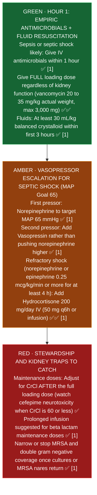

# Infectious Diseases and Stewardship: Pharmacist Core (Module 8)

**Pharmacist's job:** get the first dose out fast, pick the right drug for the syndrome and the patient's history, dose for weight and kidneys, sort out allergy labels, then narrow, switch to oral and stop on time.
**Key:** ✅✅ two independent sources · ✅ one source · ⚠️ [VERIFY]

Regimens by infection: [[Antimicrobial_Guide]]. Drug pages: [[Vancomycin]] · [[Gentamicin]]. Pediatric and neonatal: [[NICU_Core]] · [[PICU_Core]].

---

## 1. Sepsis (Surviving Sepsis Campaign 2021)
| Point | Recommendation | Check |
|---|---|---|
| Timing, shock or sepsis likely | Antimicrobials within 1 hour (strong) | ✅ [1] |
| Timing, possible sepsis without shock | Within 3 hours after rapid assessment (weak) | ✅ [1] |
| MRSA coverage | Only if high MRSA risk | ✅ [1] |
| Two gram negative agents | Only if high risk for multidrug resistance; stop the second once susceptibilities return | ✅ [1] |
| Beta lactam maintenance | Prolonged infusion suggested over standard infusion | ✅ [1] |
| Fluids | At least 30 mL/kg crystalloid in the first 3 h; balanced crystalloids suggested over saline | ✅ [1] |
| Pressors | Norepinephrine first; add vasopressin rather than raising norepinephrine | ✅ [1] · [[Norepinephrine]] |
| Steroids | Suggested when norepinephrine or epinephrine is 0.25 mcg/kg/min or more for at least 4 h | ✅ [1]; hydrocortisone 200 mg/day (50 mg q6h or infusion) ✅✅ [iatroX: steroids in refractory septic shock (SSC 2021)](https://www.iatrox.com/q/6a080366ba841a69964a57e8/steroid-use-in-refractory-septic-shock); [The Bottom Line: steroids in sepsis](https://www.thebottomline.org.uk/blog/steroids-in-sepsis/) |
| Stopping | Reassess daily; procalcitonin plus clinical judgment can guide stopping | ✅ [1] |

**Pharmacist moves:** first doses go STAT; give a full loading dose even when kidney function is poor, then adjust maintenance; vancomycin load 20 to 35 mg/kg ([[Vancomycin]]).

### Sepsis first hour priority ladder (Surviving Sepsis Campaign 2021)

*Sources: Surviving Sepsis Campaign 2021 Guideline [1]; 2020 Vancomycin Consensus Guideline [[Vancomycin]] ✅✅*

**Why the first antibiotic dose is NEVER reduced for bad kidneys (plain English):**
- **The bucket rule (volume of distribution vs clearance):** Think of the patient's body as an empty bucket that needs to be filled to the top line right now to kill bacteria. Your **first dose (loading dose)** fills the bucket, which depends only on the size of the bucket (body weight and fluid volume), **not** on the drain at the bottom (the kidneys). In sepsis, leaky capillaries and IV fluids actually make the bucket *bigger*. Your **maintenance doses** replace what leaks out the drain over time, so you only adjust the second dose onward for kidney function ✅ [1].

## 2. Beta lactam allergy
- Cross reactivity between penicillins and cephalosporins comes from the **R1 side chain**, not the beta lactam ring ✅ [2].
- **Cefazolin** shares no side chains with other US beta lactams, so cross reactivity is near zero ✅ [2].
- 2022 drug allergy practice parameter: with an unconfirmed, non anaphylactic penicillin history, **any cephalosporin can be given without testing** ✅ [2].
- Severe delayed reactions (SJS, TEN, DRESS) mean avoid the class and call allergy or ID ⚠️ [VERIFY parameter wording].
- Ask: what happened, when, how was it treated, and has the patient taken a beta lactam since? Clarifying a label is one of the highest value pharmacist interventions.

**Why cefazolin is safe in almost all penicillin allergies (plain English):**
- Old teaching blamed the square beta lactam core ring for allergies, but the immune system actually recognizes the **R1 side chain** sticking off the side like a name tag. **Cefazolin** has a completely unique side chain that does not match penicillin, amoxicillin, or any other US beta lactam, so the allergy antibody does not recognize it ✅ [2].

## 3. C. difficile (IDSA 2021)
Fidaxomicin 200 mg PO BID x 10 days preferred; vancomycin 125 mg **PO** QID x 10 days alternative. IV vancomycin does not treat C. diff ✅✅ [3][4]. See [[Cases_Anticoag_and_Verification]] case 5.
- **Why IV vancomycin fails for C. diff and PO vancomycin fails for everything else:** Vancomycin is a giant molecule that cannot cross the gut wall in either direction. Given **IV**, it stays in the blood and never reaches the inside of the colon where *C. diff* lives. Given **PO**, it stays trapped inside the gut tube (which is why it kills *C. diff* right where the toxin is made, and why oral vancomycin never treats pneumonia, skin infections, or bloodstream infections) ✅✅ [3][4].

## 4. IV to PO switch
Stable, afebrile, improving, working gut, taking other oral meds. Good oral options: fluoroquinolones, linezolid, metronidazole, TMP SMX, doxycycline, fluconazole. Separate fluoroquinolones and tetracyclines from calcium, iron, magnesium and binders ✅ (labels). Not for meningitis, endocarditis or S. aureus bacteremia without ID input ⚠️ [VERIFY]. cUTI with gram negative bacteremia can step down to oral when improving ✅ [5].

## 5. Daily catches
- **Duplicate anaerobic coverage:** metronidazole plus piperacillin tazobactam or a carbapenem ⚠️ [VERIFY local policy].
- **Cefepime and kidneys:** accumulation can cause neurotoxicity; FDA (2012): nonconvulsive status epilepticus mostly in kidney impairment without dose adjustment; adjust when CrCl is 60 mL/min or less ✅ [FDA alert on cefepime and seizures (Drugs.com)](https://www.drugs.com/fda-alerts/544-0.html).
- **Vancomycin plus piperacillin tazobactam:** more AKI; watch SCr ([[Vancomycin]]).
- **Linezolid:** serotonin syndrome with SSRIs and SNRIs; low platelets with long courses ✅ (FDA).
- **Ceftriaxone plus IV calcium in neonates:** contraindicated ([[NICU_Core]]).
- **Asymptomatic bacteriuria:** don't treat positive urine cultures without symptoms. Screen and treat only in **pregnancy** (4 to 7 days) and **before urologic procedures with mucosal trauma** (culture directed, 1 to 2 doses 30 to 60 min before). Don't treat in older adults with delirium or a fall without urinary or systemic signs, catheters, diabetes, or nonurologic surgery ✅✅ [AAFP: asymptomatic bacteriuria (IDSA 2019)](https://www.aafp.org/afp/2020/0715/p99.html); [ACP IM Matters: IDSA 2019 ASB guideline](https://immattersacp.org/weekly/archives/2019/03/26/2.htm).
- **Durations are shorter than habit:** CAP at least 5 days, HAP 7 days [10], cUTI 7 days (5 to 7 with a fluoroquinolone), cellulitis about 5 days ✅✅ [7][5][8].

## 6. Stewardship workflow (every antibiotic, day 2 to 3)
1. Cultures back? Narrow.
2. MRSA nares negative? Consider stopping vancomycin for pneumonia (negative predictive value above 95%) ✅ [9].
3. Oral option? Switch.
4. Stop date written?

## Sources
1. [Evans L, et al. Surviving Sepsis Campaign 2021. Crit Care Med 2021;49:e1063-e1143](https://doi.org/10.1097/CCM.0000000000005337) · summary: [UIC Drug Information Group: SSC 2021 pharmacotherapy updates](https://dig.pharmacy.uic.edu/faqs/2022-2/march-2022-faqs/update-what-are-the-2021-pharmacotherapy-updates-to-the-surviving-sepsis-campaign-international-guidelines-for-management-of-sepsis-and-septic-shock) · [SCCM guideline page](https://sccm.org/sepsisguidelines)
2. [Brameli, Stone, Phillips. J Allergy Clin Immunol Glob 2024 (cites 2022 practice parameter)](https://pmc.ncbi.nlm.nih.gov/articles/PMC11609518)
3. [Johnson S, et al. IDSA/SHEA 2021 focused update on C. difficile. Clin Infect Dis 2021;73:e1029-e1044](https://doi.org/10.1093/cid/ciab549) · summary: [AAFP: IDSA 2021 C. difficile update](https://www.aafp.org/afp/2022/0600/p678)
4. [UIC Drug Information Group: 2021 C. difficile update](https://dig.pharmacy.uic.edu/faqs/2021-2/november-2021-faqs/what-are-the-2021-guideline-updates-on-the-management-of-clostridioides-difficile-infection-cdi-in-adults)
5. [Trautner BW, et al. IDSA 2025 guideline on complicated UTI. Clin Infect Dis 2025](https://doi.org/10.1093/cid/ciaf460) · summary: [emDocs: 2025 IDSA complicated UTI guideline](https://www.emdocs.net/guideline-update-2025-idsa-management-of-complicated-uti/)
6. [UNMC: cUTI summary](https://www.unmc.edu/intmed/_documents/id/asp/cuti_summary.pdf)
7. [Metlay JP, et al. ATS/IDSA CAP guideline. Am J Respir Crit Care Med 2019;200:e45-e67](https://doi.org/10.1164/rccm.201908-1581ST) · summary: [emDocs: ATS/IDSA 2019 CAP update](https://www.emdocs.net/community-acquired-pneumonia-ats-idsa-guidelines-update/) · [AAFP: CAP 2019 guideline](https://www.aafp.org/pubs/afp/issues/2020/0715/p121.pdf)
8. [AHRQ: Cellulitis clinician guide](https://www.ahrq.gov/sites/default/files/wysiwyg/antibiotic-use/telemedicine/cellulitis-clinician-guide.pdf)
9. [Kalil AC, et al. IDSA/ATS HAP and VAP guideline. Clin Infect Dis 2016;63:e61-e111](https://doi.org/10.1093/cid/ciw353) · summary: [UCSF: HAP/VAP algorithm](https://idmp.ucsf.edu/node/16091)
10. [Emergency Care BC: HAP treatment](https://emergencycarebc.ca/clinical_resource/hospital-acquired-pneumonia-adult-treatment)

## Verify locally at St. Mary's
- Sepsis order set and whether beta lactams run as extended infusions after the first STAT dose.
- Pharmacy to dose vancomycin and aminoglycoside policy (Bayesian software vs two level pharmacokinetics).
- IV to PO automatic conversion policy and eligible medications.
- Restricted antimicrobial approval list and C. difficile testing/treatment algorithm.

*Last verified: 2026-10-17.*
