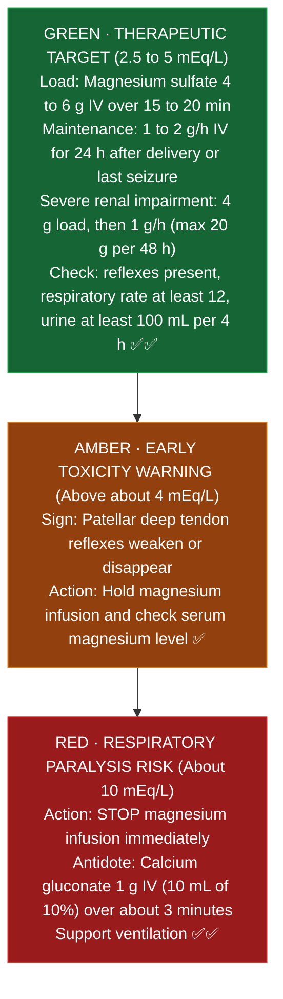
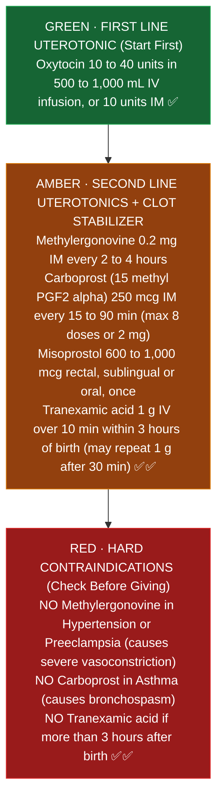

# Labor & Delivery: Pharmacist Core

**Pharmacist's job on L&D:** verify high alert infusions (magnesium, oxytocin), get emergency drugs out fast (hypertension, hemorrhage, eclampsia), check every drug for pregnancy and lactation safety, and catch the classic contraindications.

**Watch first:** <a href="https://notebook.google.com/notebook/57e84ff1-88ae-4b28-863e-38afc3cf0636/artifact/edc9d903-2199-4d0d-adc0-57e84ace4849" target="_blank">Night Shift L&D Playbook</a> (8 minute video made from this page in your notebook; opens in Gemini Notebook).

Sources: ACOG Practice Bulletin 222 (2020, gestational hypertension and preeclampsia); ACOG Committee Opinion 767 (2019, acute severe hypertension); ACOG Committee Opinion 797 (2020, GBS prophylaxis); ACOG Practice Bulletin 183 (2017, postpartum hemorrhage); WOMAN trial (Lancet 2017, TXA); ISMP High Alert list (magnesium sulfate IV, oxytocin IV).

---

## 1. Acute severe hypertension (preeclampsia, eclampsia)
**Threshold:** SBP 160 or higher, or DBP 110 or higher, persistent for 15 minutes. Treat within 30 to 60 minutes (ACOG CO 767, 2019).

| Drug | Regimen (ACOG CO 767) | Pharmacist watch |
|---|---|---|
| Labetalol IV | 20 mg over 2 min; repeat BP in 10 min; if high, 40 mg; then 80 mg; if still high, switch to hydralazine. Max 300 mg cumulative | Avoid in asthma, heart failure, heart block; bradycardia (maternal and neonatal) |
| Hydralazine IV | 5 to 10 mg over 2 min; repeat BP in 20 min; if high, 10 mg; if still high, switch to labetalol | Maternal hypotension and tachycardia; watch fetal heart rate |
| Nifedipine immediate release PO | 10 mg; repeat BP in 20 min; if high, 20 mg; then 20 mg; if still high, switch to labetalol | Oral only. Never sublingual. Good option with no IV access |

**How it works and timing in the body (plain English):**
- **Why recheck BP at 10 minutes for IV labetalol vs 20 minutes for IV hydralazine and oral nifedipine:** IV labetalol blocks alpha 1 and beta receptors right away (onset 2 to 5 minutes, peak 5 to 15 minutes), so you know by **10 minutes** if the dose worked. IV hydralazine directly relaxes arterial muscle and takes longer to peak (10 to 20 minutes), and immediate release oral nifedipine must be swallowed and absorbed from the gut (15 to 20 minutes), so both are rechecked at **20 minutes** (ACOG CO 767, 2019) ✅.
- **Why nifedipine is PO only (never sublingual, never bitten, never IV):** Nifedipine opens arteries by blocking calcium channels. If a capsule is bitten, placed under the tongue, or given IV, the entire dose hits the blood at once and drops the mother's blood pressure too fast. Because the placenta cannot auto regulate its own blood pressure, a sudden maternal BP crash starves the baby of blood flow (causing fetal heart rate drops) and triggers maternal reflex tachycardia (ACOG CO 767, 2019) ✅.

**Quote it:** "ACOG recommends treating BP of 160 or 110 within 30 to 60 minutes with IV labetalol, IV hydralazine or immediate release oral nifedipine."

## 2. Magnesium sulfate (ISMP high alert)
**Uses:** seizure prophylaxis in preeclampsia with severe features; eclampsia treatment; fetal neuroprotection before 32 weeks.

- **Dose (ACOG PB 222):** 4 to 6 g IV load over 15 to 20 minutes (FDA label: over 15 minutes), then 1 to 2 g/h. Continue 24 hours after delivery (or after the last seizure). IM option: 10 g (5 g each buttock), then 5 g IM every 4 hours.
- **Recurrent seizure on magnesium:** additional 2 to 4 g IV over 5 minutes.
- **Renal:** magnesium is renally cleared. FDA label for severe renal impairment or oliguria: 4 g load, then 1 g/h, max 20 g per 48 h, with serum levels; keep urine output at least 100 mL per 4 hours. See [[Magnesium_Sulfate]].
- **Monitoring:** deep tendon reflexes, respiratory rate (concern if under 12), urine output, mental status, oxygen saturation; serum magnesium if renal impairment or toxicity is suspected.
- **Toxicity (FDA label):** reflexes weaken above about 4 mEq/L; respiratory paralysis risk at about 10 mEq/L. Label eclampsia target 2.5 to 5 mEq/L (3 to 6 mg/dL). Textbooks quote higher thresholds; follow the label and St. Mary's protocol. Corrected 2026-10-17 (earlier version used higher textbook numbers).
- **Antidote:** stop the infusion; calcium gluconate 1 g IV (10 mL of 10%) over about 3 minutes; support ventilation.
- **Safety:** use premixed bags and a dedicated pump channel; the classic error is the loading bag running at the maintenance setting or a 20 g bag running wide open (ISMP). Avoid with myasthenia gravis.

### Magnesium sulfate dosing and toxicity ladder

*Sources: ACOG Practice Bulletin 222 (2020); FDA label, Magnesium Sulfate in 5% Dextrose Injection (2019) ✅✅*

**How it works in the body (plain English):**
- **The brake pedal on nerves:** Magnesium sits on calcium channels at nerve endings so overexcited brain nerves cannot fire into an eclamptic seizure.
- **Why knee reflexes vanish before breathing stops:** The nerves that control your knee jerk reflex are more sensitive to rising magnesium than your breathing muscle (diaphragm) is. Losing knee reflexes (above about 4 mEq/L) is your built in alarm bell to stop the pump before magnesium reaches the level that stops breathing (about 10 mEq/L) (FDA label) ✅.
- **Why calcium gluconate fixes it in minutes:** Calcium and magnesium compete for the exact same doorway on nerves and muscles. Flooding the blood with **calcium gluconate 1 g IV over about 3 minutes** pushes magnesium out of the way so the diaphragm can contract again (FDA label) ✅.

**Quote it:** "Loss of deep tendon reflexes comes before respiratory depression; that's why nurses check reflexes on magnesium, and the antidote is 1 g of calcium gluconate."

## 3. Oxytocin (ISMP high alert)
- Standardized concentration and pump library are the safety net [VERIFY St. Mary's concentration, for example 30 units in 500 mL].
- Watch for tachysystole (more than 5 contractions in 10 minutes) and water intoxication (hyponatremia) with long, high dose infusions (oxytocin looks structurally similar to antidiuretic hormone, so high doses tell the kidneys to hold onto free water).
- Look alike risk: oxytocin bags near magnesium bags. Check the label every time.

## 4. Postpartum hemorrhage (ACOG PB 183, 2017; WOMAN 2017)
Order of use and the one contraindication to remember for each:

| Drug | Typical dose | Do not use if |
|---|---|---|
| Oxytocin | 10 to 40 units in 500 to 1,000 mL IV infusion, or 10 units IM | (first line) |
| Methylergonovine | 0.2 mg IM every 2 to 4 hours | **Hypertension or preeclampsia** |
| Carboprost (15 methyl PGF2 alpha) | 250 mcg IM every 15 to 90 minutes, max 8 doses (2 mg) | **Asthma** |
| Misoprostol | 600 to 1,000 mcg rectal, sublingual or oral, once | (fever and shivering are common) |
| Tranexamic acid | 1 g IV over 10 minutes; may repeat 1 g after 30 minutes if bleeding continues | Give within 3 hours of birth (WOMAN trial) |

### Postpartum hemorrhage (PPH) drug order ladder

*Sources: ACOG Practice Bulletin 183 (2017, postpartum hemorrhage); WOMAN trial (Lancet 2017, tranexamic acid) ✅✅*

**How each PPH drug works in the body (why the contraindications exist):**
- **The goal:** After the placenta delivers, the uterus must squeeze tightly like a fist to pinch shut the open blood vessels where the placenta was attached.
- **Oxytocin (first line):** Squeezes the upper uterus rhythmically; works in 1 to 2 minutes IV (3 to 5 minutes IM) and is safe in both hypertension and asthma (ACOG PB 183, 2017) ✅.
- **Methylergonovine (why never in hypertension):** Clamps down smooth muscle in the uterus **and** inside blood vessel walls. In a patient with high blood pressure or preeclampsia, clamping blood vessels can spike blood pressure into stroke range (ACOG PB 183, 2017) ✅.
- **Carboprost (why never in asthma):** A prostaglandin F2 alpha drug that squeezes smooth muscle in the uterus **and** in the lung airways. In a patient with asthma, squeezing the airways triggers severe bronchospasm (ACOG PB 183, 2017) ✅.
- **Tranexamic acid (why within 3 hours):** Instead of squeezing the uterus, TXA stops the body from dissolving blood clots that are trying to seal the bleeding vessels. Giving 1 g IV within **3 hours** of birth reduces death from bleeding (WOMAN trial, 2017) ✅.

**Quote it:** "No methylergonovine in hypertension, no carboprost in asthma, and TXA within 3 hours."

## 5. GBS prophylaxis in labor (ACOG CO 797, 2020)
| Situation | Regimen |
|---|---|
| No penicillin allergy | Penicillin G 5 million units IV, then 2.5 to 3 million units IV every 4 hours until delivery |
| Alternative | Ampicillin 2 g IV, then 1 g IV every 4 hours |
| Penicillin allergy, low risk for anaphylaxis | Cefazolin 2 g IV, then 1 g IV every 8 hours |
| High risk allergy, isolate clindamycin susceptible | Clindamycin 900 mg IV every 8 hours |
| High risk allergy, resistant or unknown | Vancomycin 20 mg/kg IV every 8 hours (max 2 g per dose) |

Adequate prophylaxis = a beta lactam (penicillin, ampicillin or cefazolin) started at least 4 hours before delivery. This matters to the NICU team, so it is worth documenting clearly.
Many "penicillin allergies" are low risk; allergy clarification is a high value pharmacist intervention here.

## 6. Other L&D drugs to know
- **Antenatal corticosteroids:** betamethasone 12 mg IM every 24 hours for 2 doses (24 0/7 to 33 6/7 weeks; late preterm use has specific criteria) (ACOG CO 713, 2017). **Late preterm (34 0/7 to 36 6/7 weeks):** one course of betamethasone if at risk of delivery within 7 days and no prior course; not studied in multiples or pregestational diabetes; not with chorioamnionitis; watch the newborn for hypoglycemia (ALPS trial) ✅ [MDedge: late preterm antenatal steroids (ALPS, ACOG)](https://mdedge.com/content/start-offering-antenatal-corticosteroids-women-delivering-between-34-0/7-and-36-6/7-weeks).
- **Tocolytics:** nifedipine; indomethacin only before 32 weeks and for no more than 48 hours (ductus arteriosus constriction, oligohydramnios). Terbutaline: FDA boxed warning against prolonged use (beyond 48 to 72 hours) for preterm labor.
- **Rh(D) immune globulin:** 300 mcg IM at about 28 weeks and within 72 hours after delivery when an Rh negative mother has an Rh positive infant.
- **Epidural and neuraxial:** know your anticoagulation timing rules before neuraxial procedures (ASRA guidelines) [module 7].
- **Lactation:** use LactMed (NIH) as the free reference.

## Verify locally at St. Mary's
- Magnesium order set: load, maintenance, renal adjustment, level timing.
- Hypertension in pregnancy order set and which agent is first line.
- Oxytocin concentration and pump library.
- PPH kit or cart contents and who brings it.
- GBS order set and allergy pathway.
