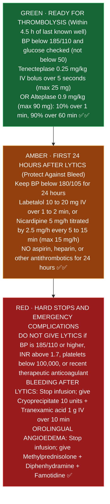
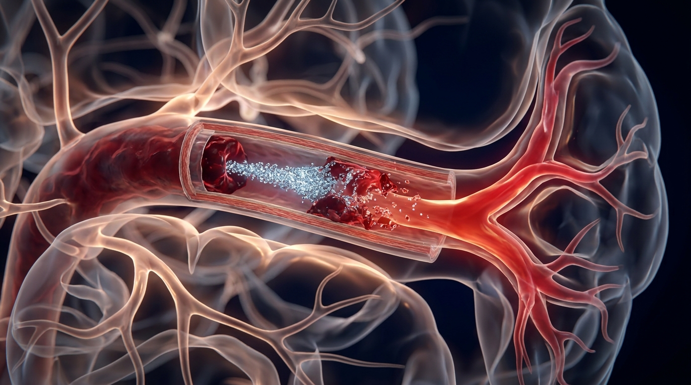
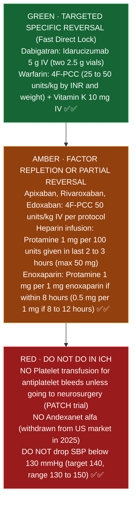

# Stroke (Comprehensive Stroke Center): Pharmacist Core

**Pharmacist's job in a stroke alert:** confirm weight, check for contraindications (anticoagulants, recent surgery, platelets, glucose), prepare and double check the thrombolytic fast (door to needle goal), manage BP before and after, and set up antithrombotic therapy after.

Sources: AHA/ASA 2026 Guideline for the Early Management of Patients With Acute Ischemic Stroke (Prabhakaran et al., Stroke, published January 26, 2026); AHA/ASA 2022 Guideline for Spontaneous Intracerebral Hemorrhage; AHA/ASA 2023 Aneurysmal Subarachnoid Hemorrhage Guideline; FDA approval of tenecteplase (TNKase) for acute ischemic stroke (March 2025); Andexxa US market withdrawal (2025).

---

## 1. Ischemic stroke: thrombolysis (AHA/ASA 2026)
- **Tenecteplase is now equally preferred to alteplase** (2026). Advantage: a single bolus, fewer mixing and infusion errors.
- **Time:** within 4.5 hours of last known well. Selected patients up to 9 hours based on advanced imaging (2026).
- **Not for mild, nondisabling symptoms** (symptoms that don't affect daily activities or the ability to work).

| Agent | Dose | Key safety point |
|---|---|---|
| Tenecteplase | 0.25 mg/kg IV bolus over 5 seconds, max 25 mg | The cardiac (STEMI) dose is different and higher. Use the stroke dose only; many sites stock a dedicated stroke kit or dosing chart |
| Alteplase | 0.9 mg/kg, max 90 mg: 10% as bolus over 1 minute, the rest over 60 minutes | After the infusion, the dead volume in the tubing must be flushed so the full dose is given [VERIFY St. Mary's procedure] |

**Before lytics:** BP below 185/110. Glucose checked (treat if below 50; hypoglycemia can mimic stroke). Platelets and INR are not required before starting unless a problem is suspected, but know the contraindications (for example INR above 1.7, platelets below 100,000, therapeutic heparin or enoxaparin, or a recent DOAC dose) [VERIFY 2026 wording on DOACs].

**After lytics, for 24 hours:** BP below 180/105. No antithrombotics for 24 hours (unless specifically indicated). Neuro checks.

**BP agents:** labetalol 10 to 20 mg IV over 1 to 2 minutes (may repeat once), nicardipine infusion 5 mg/h titrated by 2.5 mg/h every 5 to 15 minutes (max 15 mg/h), clevidipine 1 to 2 mg/h titrated (max 21 mg/h).

**Angioedema after alteplase or tenecteplase** (more common with ACE inhibitors): stop the infusion, give methylprednisolone, diphenhydramine and famotidine; epinephrine if it worsens; icatibant or C1 esterase inhibitor may be considered.

**Bleeding after a thrombolytic:** stop it; cryoprecipitate 10 units, and tranexamic acid 1 g IV over 10 minutes or aminocaproic acid as an alternative [VERIFY order set].

### Acute ischemic stroke thrombolysis and BP ladder

*Sources: AHA/ASA 2026 Acute Ischemic Stroke Guideline; FDA TNKase label (2025) ✅✅*

**How it works and timing in the body (plain English):**
- **How tenecteplase and alteplase dissolve the clot:** Both drugs turn plasminogen into plasmin, which acts like molecular scissors that cut up the fibrin mesh holding a blood clot together. Tenecteplase is a modified version of alteplase that stays in the blood longer (half life about 20 to 24 minutes vs 4 to 5 minutes for alteplase) and aims more specifically at fibrin inside the clot, which is why **tenecteplase is a single 5 second IV push** while alteplase requires a 1 minute bolus followed by a 60 minute infusion (AHA/ASA 2026) ✅✅.
- **Why BP must be below 185/110 before and below 180/105 after:** Brain tissue starved of oxygen has fragile, leaky blood vessel walls. Pushing a clot busting drug while blood pressure is hammering against those fragile vessels above 185/110 can blow the vessel open and turn an ischemic stroke into a fatal brain bleed (hemorrhagic transformation) (AHA/ASA 2026) ✅.
- **Why stroke patients on ACE inhibitors get tongue swelling (angioedema) from lytics:** Plasmin (activated by tenecteplase or alteplase) also turns on bradykinin, a chemical that makes lips and the tongue swell. Normally, ACE enzymes break down bradykinin; when a patient takes an ACE inhibitor (such as lisinopril), bradykinin cannot be broken down and builds up in the tongue and airway (AHA/ASA 2026) ✅.
- **Real shift picture (what happens when the stroke pager goes off):** You hear "Stroke Alert, CT Scanner." Before mixing anything, look at two numbers on the screen: the patient's **weight in kg** and the **blood pressure**. If the vial in your hand is **tenecteplase**, remember the vial holds **50 mg** (the heart attack size), while the maximum brain stroke dose is **25 mg** (0.25 mg/kg). Draw up only the stroke dose into the syringe before handing it to the nurse so the extra 25 mg can never be pushed by mistake ✅.

## 2. Ischemic stroke: after the acute phase
- **Minor stroke or high risk TIA:** dual antiplatelet therapy (aspirin + clopidogrel, 21 days). 2026 update: can be used for NIHSS 4 or 5 (not only 3 or less) and can start within 72 hours.
- Load clopidogrel 300 to 600 mg, then 75 mg daily; aspirin 160 to 325 mg load, then 81 mg daily.
- Atrial fibrillation: start a DOAC; timing depends on stroke size (ELAN and TIMING trials support earlier starts) [VERIFY 2026 recommendation].
- High intensity statin.
- Glucose 140 to 180 mg/dL in the hospital.
- VTE prophylaxis: enoxaparin or heparin once safe; intermittent pneumatic compression.

## 3. Intracerebral hemorrhage (AHA/ASA 2022)
- **BP:** for mild to moderate ICH with SBP 150 to 220, lowering to a target of 140 (keeping it in 130 to 150) is reasonable; **avoid dropping below 130**. Smooth, sustained control (nicardipine or clevidipine drips) matters.
- **Reversal (the pharmacist's biggest job here):**

| Drug | Reversal |
|---|---|
| Warfarin | 4F-PCC (dose by INR and weight per protocol) + vitamin K 10 mg IV |
| Dabigatran | Idarucizumab 5 g IV (two 2.5 g vials) |
| Apixaban, rivaroxaban, edoxaban | 4F-PCC 50 units/kg (per protocol). Andexanet alfa was withdrawn from the US market in 2025 |
| Heparin infusion | Protamine 1 mg per 100 units of heparin given in the last 2 to 3 hours (max 50 mg) |
| Enoxaparin | Protamine 1 mg per 1 mg enoxaparin if within 8 hours (0.5 mg per 1 mg if 8 to 12 hours) |
| Antiplatelets | Platelet transfusion is **not** recommended unless the patient is going to surgery (PATCH trial) |

### Intracerebral hemorrhage (ICH) anticoagulant reversal ladder

*Sources: AHA/ASA 2022 Spontaneous Intracerebral Hemorrhage Guideline; PATCH trial (Lancet 2016) ✅✅*

- No seizure prophylaxis routinely. Treat hyperglycemia and fever. VTE prophylaxis with heparin or enoxaparin can start 24 to 48 hours after the bleed is stable.

## 4. Aneurysmal subarachnoid hemorrhage (AHA/ASA 2023)
- **Nimodipine 60 mg orally or by tube every 4 hours for 21 days.** Oral only; **never IV** (deaths have occurred when capsule contents were injected; FDA boxed warning). If BP drops, 30 mg every 2 hours.
- BP control before the aneurysm is secured (common target SBP below 160) [VERIFY].
- Reversal of any anticoagulant; levetiracetam is preferred over phenytoin if an antiseizure drug is used.

**How nimodipine works and why it can NEVER be given IV (plain English):**
- **Why we give nimodipine for 21 days after a burst brain aneurysm:** Between days 3 and 21 after blood spills around the outside of the brain, irritated cerebral arteries clamp down in delayed spasm (cerebral vasospasm), which can cause a secondary stroke. Nimodipine is a fat soluble calcium channel blocker that enters the brain and keeps those vessels open (AHA/ASA 2023) ✅.
- **Why injecting nimodipine IV is fatal:** Nimodipine comes as a liquid filled gel capsule so nurses can extract the liquid for patients with a feeding tube. Because it is drawn up into a syringe, nurses have accidentally connected that syringe to an IV line. Swallowed in the gut, the liver clears most of the drug smoothly over time; injected straight into a vein, the concentrated liquid and its alcohol solvent cause instant, irreversible cardiovascular collapse and death. Always use **oral/enteral only syringes** labeled "Not for IV Use" (FDA boxed warning; ISMP) ✅✅.

## 5. Stroke alert checklist (pharmacist)
1. Weight: measured or estimated? (Tenecteplase dosing is weight banded.)
2. Last known well time. Anticoagulant, and when was the last dose?
3. BP below 185/110? If not, have labetalol or nicardipine ready.
4. Glucose done?
5. Prepare tenecteplase or alteplase; independent double check of dose and drug (tenecteplase vs alteplase look alike packaging; stroke vs cardiac dose).
6. Document time of bolus (door to needle).

## Verify locally at St. Mary's
- Which thrombolytic St. Mary's uses for stroke, and the dosing chart.
- Stroke alert pharmacist response (does pharmacy go to the ED or CT?).
- Anticoagulant reversal order set (4F-PCC dosing method).
- Post thrombectomy BP targets in the order set.
