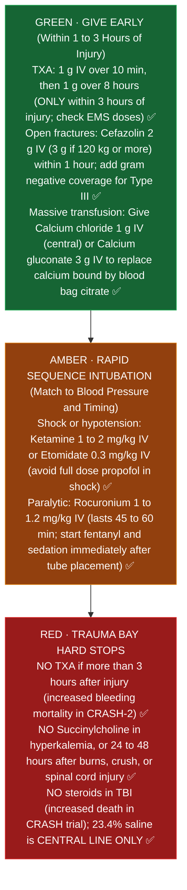

# Trauma (Level I): Pharmacist Core

**Pharmacist's job in a trauma activation:** TXA on time, anticoagulant reversal fast, RSI drugs, antibiotics for open fractures, tetanus, brain injury osmotherapy, and later pain, VTE prophylaxis and withdrawal.

Sources: CRASH-2 (Lancet 2010) and CRASH-3 (Lancet 2019, TBI); ACS TQIP best practice guidelines (massive transfusion; TBI); Brain Trauma Foundation 4th ed. (2016); EAST practice management guidelines (open fracture antibiotics; VTE prophylaxis); CDC tetanus guidance; AHA/ASA 2022 ICH reversal table ([[Stroke_Core]]).

---

## 1. Tranexamic acid (TXA)
- **Dose (CRASH-2):** 1 g IV over 10 minutes, then 1 g over 8 hours.
- **Timing:** within 3 hours of injury. **Benefit is greatest when given early; after 3 hours it may cause harm** (CRASH-2 subgroup).
- TBI: CRASH-3 showed benefit in mild to moderate TBI when given within 3 hours.
- Some EMS systems give 2 g as a single prehospital bolus; check what was already given before ordering more.

**Quote it:** "CRASH-2: 1 g over 10 minutes then 1 g over 8 hours, and only within 3 hours of injury."

## 2. Massive transfusion
- Balanced ratio of plasma, platelets and red cells, close to 1:1:1 (PROPPR trial, ACS TQIP).
- **Calcium:** citrate in blood products drops ionized calcium. Expect calcium chloride 1 g IV (central preferred) or calcium gluconate 3 g per protocol, guided by ionized calcium.
- Watch potassium (rises with stored blood) and temperature.

### Trauma bay first hour drug and safety ladder

*Sources: CRASH-2 (Lancet 2010); ACS TQIP Massive Transfusion & TBI Guidelines; Brain Trauma Foundation 4th ed. (2016); EAST Open Fracture Guideline (2022) ✅✅*

**How trauma drugs work in the body (plain English for fast recall):**
- **Why bags of blood drop the patient's calcium (the citrate sponge):** Blood bank bags contain **citrate** to keep donated blood from clotting in the bag, and citrate works by grabbing onto calcium. When a trauma patient gets rapid units of blood and plasma, all that citrate enters the patient's veins and sponges up the patient's own ionized calcium. Without calcium, the heart cannot squeeze (hypotension) and blood cannot clot (coagulopathy). Giving **calcium chloride 1 g IV (central) or calcium gluconate 3 g IV** refills the calcium tank (ACS TQIP) ✅.
- **Why succinylcholine is safe in the first hour of a burn/crush, but fatal 24 to 48 hours later:** Succinylcholine paralyzes muscles by opening acetylcholine channels on muscle cells, which lets a tiny puff of potassium leak out (normally raising K by about 0.5 mEq/L). Starting **24 to 48 hours** after a major burn, crush injury, or spinal cord injury, damaged muscle cells sprout thousands of extra receptors across their entire surface. If you give succinylcholine then, all those extra doors fly open at once and dump a massive wave of potassium into the blood, stopping the heart ✅.
- **Why paralyzed patients wake up terrified if you forget post intubation analgesia/sedation:** **Etomidate** (induction) wears off in **5 to 10 minutes**, while **rocuronium** (paralytic) keeps the patient completely unable to move or blink for **45 to 60 minutes**. Always hang **fentanyl** and **propofol or dexmedetomidine** immediately after the breathing tube goes in ✅.

## 3. Anticoagulated trauma patient
Same reversal table as ICH ([[Stroke_Core]] section 3). Find out the anticoagulant and the time of the last dose immediately; this is where pharmacists save minutes.

## 4. Rapid sequence intubation (adult)
| Drug | Dose | Watch |
|---|---|---|
| Ketamine | 1 to 2 mg/kg IV | Good in hypotension; raises secretions |
| Etomidate | 0.3 mg/kg IV | Adrenal suppression (single dose) |
| Propofol | 1 to 2.5 mg/kg IV | Hypotension: avoid or reduce in shock |
| Rocuronium | 1 to 1.2 mg/kg IV | Reversal: sugammadex 16 mg/kg for immediate reversal |
| Succinylcholine | 1 to 1.5 mg/kg IV | Avoid with hyperkalemia, burns or crush injury after 24 to 48 hours, spinal cord injury after the first days, neuromuscular disease, history of malignant hyperthermia |

**Post intubation:** analgesia first (fentanyl), then sedation (propofol, dexmedetomidine). Paralyzed patients must be sedated; rocuronium lasts longer than etomidate.

## 5. Traumatic brain injury (BTF 2016; ACS TQIP)
- Avoid hypotension and hypoxia.
- **Osmotherapy:** mannitol 0.25 to 1 g/kg IV, or hypertonic saline (3% 250 mL, or 23.4% 30 mL **central line only**, ISMP high alert).
- **Seizure prophylaxis** for severe TBI for 7 days (phenytoin per BTF; levetiracetam is widely used) [VERIFY St. Mary's choice].
- Steroids are **not** recommended in TBI (CRASH trial).

## 6. Open fractures (EAST 2022)
- Start antibiotics as soon as possible (within 1 hour).
- Type I and II: cefazolin 2 g IV (3 g if 120 kg or more).
- Type III: cefazolin plus gram negative coverage (for example ceftriaxone, or cefazolin + gentamicin per protocol) [VERIFY order set]. Add penicillin for farm or soil contamination.

## 7. Tetanus (CDC)
- Clean minor wound: Tdap or Td if more than 10 years since last dose.
- Dirty or major wound: Tdap or Td if more than 5 years; plus **tetanus immune globulin 250 units IM** if vaccination history is unknown or fewer than 3 doses.

## 8. After the trauma bay
- **VTE prophylaxis:** enoxaparin (commonly 30 mg every 12 hours or 40 mg daily, weight and anti Xa adjusted per protocol) once bleeding risk allows, often within 24 to 48 hours (EAST, ACS TQIP) [VERIFY protocol].
- **Pain:** multimodal (acetaminophen, NSAIDs if no bleeding or kidney concern, regional anesthesia, ketamine, opioids). Rib fractures benefit from regional blocks and scheduled nonopioids.
- **Alcohol withdrawal:** CIWA based benzodiazepines or phenobarbital protocols; thiamine before glucose.
- **Stress ulcer prophylaxis** for coagulopathy, shock or chronic liver disease (SCCM/ASHP 2024; ventilation alone is not an established indication). Updated 2026-10-17 (was "ventilated or coagulopathic"); see [[Adult_Critical_Care]].
- **Burns:** Parkland formula, 4 mL/kg per % TBSA of lactated Ringer's in 24 hours, half in the first 8 hours (from time of burn).
- **Spinal cord injury:** high dose methylprednisolone is not recommended routinely.

## Trauma activation checklist (pharmacist)
1. Weight (estimated) and allergies.
2. Anticoagulants or antiplatelets? Last dose time?
3. TXA: injury time? Under 3 hours? Already given by EMS?
4. RSI kit ready; post intubation sedation.
5. Open fracture: cefazolin. Tetanus status.
6. Head injury: hypertonic saline or mannitol ready.

## Verify locally at St. Mary's
- Trauma activation pharmacist response.
- TXA protocol and EMS doses.
- Massive transfusion protocol and calcium replacement.
- Open fracture antibiotic order set; VTE prophylaxis protocol for trauma.
