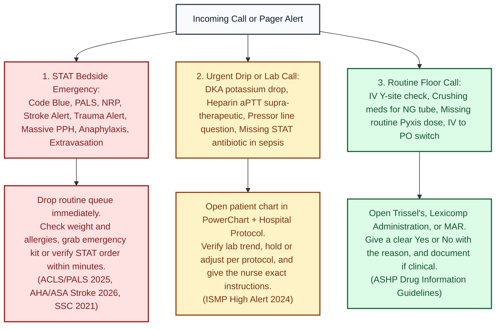

# Daily and Shift Routine

## The pharmacist workup (use for every order you verify that is not routine)
Based on the JCPP Pharmacists' Patient Care Process: Collect, Assess, Plan, Implement, Follow up.

1. **Who:** age, weight (dosing weight for peds and neonates, in kg only), height, allergies with reaction type, pregnancy or lactation status.
2. **Why:** indication. If you can't name it, ask.
3. **Organs:** SCr and CrCl or eGFR, urine output, LFTs, platelets and INR for anticoagulants.
4. **Drug check:** dose, route, frequency, duration, max dose, concentration, compatibility, duplication, interactions, high alert status.
5. **Monitor:** what level, lab or vital sign tells you it is working or hurting, and when.
6. **Communicate:** if you call, use SBAR: Situation, Background, Assessment, Recommendation. End with a specific recommendation and a guideline you can name.

## How to sound like a resident on the phone
> "Dr. ___, this is Shallanda, the pharmacist. I'm calling about [patient] in [room]. The [drug] order is [dose]; with a CrCl of 28, the [source, year] recommends [change]. Would you like me to adjust it to [specific order]?"

Name the source and year. Give the exact order. Let them say yes.

## Daily 20 minutes
- 1 case from [[Cases_LD_NICU_PICU]], timed, out loud.
- 1 item from ISMP or FDA (see [[Stay_Current]]).

## Weekly 2 hours
- 1 module page, then the "Verify locally" list for that module at work.

---

## Night Shift Phone Call & Pager Survival Guide

When you are the only pharmacist covering a unit or working evenings and nights, the phone and pager can feel intimidating at first. Use this decision ladder to triage what happens first, and use the scripts below so you never freeze on the phone.

*Sources: JCPP Pharmacists' Patient Care Process; ISMP High Alert Medications 2024; AHA/ASA 2026; Surviving Sepsis Campaign 2021.*

### Word for word scripts for the 7 most common hospital calls

| Who is calling & what happened | What you check first (10 seconds) | Exact words to say on the phone |
|---|---|---|
| **1. Nurse: "Can I Y-site Drug A and Drug B together?"** | Open **Trissel's IV Compatibility** (Y-site tab). Check the **exact concentrations** and **diluents** on the patient's MAR (see [[IV_Compatibility]]). | • **If Compatible:** *"Yes, according to Trissel's, [Drug A] at [conc] and [Drug B] at [conc] are Y-site compatible."* • **If Incompatible or Variable/No Data:** *"No, do not Y-site those two; they can precipitate or inactivate each other. Please run them in separate lumens, or pause one, flush the line with normal saline before and after, and then run the second."* |
| **2. Nurse: "My DKA patient's potassium just came back at 3.1 and the insulin drip is running!"** | Open PowerChart Labs: check **K+**, **SCr**, **urine output**, and **Mg** (see [[Insulin_IV_DKA]]). | *"Hold the insulin drip right now. Because insulin pushes potassium into the cells, running insulin with a potassium below 3.5 mEq/L can trigger a fatal arrhythmia (ADA DKA consensus / FDA label). Let's start IV potassium repletion per protocol (max 10 mEq/h peripherally) and check magnesium; once repeat potassium is above 3.3 to 3.5 mEq/L, we can restart the insulin drip."* |
| **3. Nurse: "The norepinephrine IV infiltrated and the patient's arm looks pale and cold!"** | Open [[IV_Compatibility]] and [[Norepinephrine]]. Locate **phentolamine** right away. | *"Leave the infiltrated catheter in place if you can aspirate fluid from it, stop the norepinephrine on that line, and restart the pressor on a different line immediately. Do not put a cold pack on it; elevate the arm and use a warm compress. We are sending phentolamine 5 to 10 mg diluted in 10 to 15 mL normal saline for local subcutaneous infiltration around the site as soon as possible (works best within 12 hours per FDA label)."* |
| **4. Nurse: "Can I crush the patient's home meds for their new NG tube?"** | Check every oral order against the **ISMP Do Not Crush** list and Lexicomp *Administration* tab (see [[Med_Safety_and_Florida_Law]]). | *"Never crush extended release, enteric coated, or sublingual tablets. Let me check their MAR right now: I will switch any extended release or enteric coated meds to an immediate release tablet or oral liquid equivalent and re-time any levothyroxine, phenytoin, or fluoroquinolone around tube feeds."* |
| **5. Nurse: "The patient has a penicillin allergy and the doctor ordered cefepime (or ceftriaxone)!"** | Check allergy reaction type on the banner + side chain similarity (see [[ID_Core]]). | • **If rash/hives or unknown (non severe):** *"Cefepime and ceftriaxone have completely different R1 side chains from penicillins, so cross reactivity is below 1 to 2% (AAAAI/ACAAI 2022). It is safe to give without skin testing."* • **If SJS, TEN, or DRESS:** *"Because the patient had a severe blistering reaction (SJS/TEN/DRESS), we must avoid all beta lactams; I am calling the physician right now to switch to a non beta lactam."* |
| **6. Stroke Alert or Trauma Alert Pager Goes Off** | Open [[Stroke_Core]] or [[Trauma_Core]] and pull up the patient's weight, last known well time, INR/platelets, and anticoagulant history. | • **Stroke:** *"I have the patient's weight of [X] kg. If we give tenecteplase, the stroke dose is 0.25 mg/kg (max 25 mg) IV push over 5 seconds; blood pressure must be below 185/110 before we push (AHA/ASA 2026)."* • **Trauma:** *"If we are within 3 hours of injury with significant bleeding, TXA is 1 g IV over 10 minutes followed by 1 g over 8 hours (CRASH-2 2010), and we have calcium gluconate ready for massive transfusion."* |
| **7. Physician pushes back: "Just verify it anyway, that's how I always order it."** | Stay calm, cite the exact safety mechanism and hospital policy or FDA boxed warning, and offer the safe alternative that accomplishes their goal. | *"Dr. ___, I want to get this started for your patient right away. The reason I cannot verify [current order] as written is [specific safety risk, for example: CrCl is 22 mL/min which doubles enoxaparin bleeding risk per the FDA label / hospital protocol]. I can modify it right now to [safe protocol dose] so the nurse can give it immediately. Does that work for you?"* (If a life threatening error still cannot be resolved, escalate up your pharmacy clinical leadership chain per hospital policy.) |

