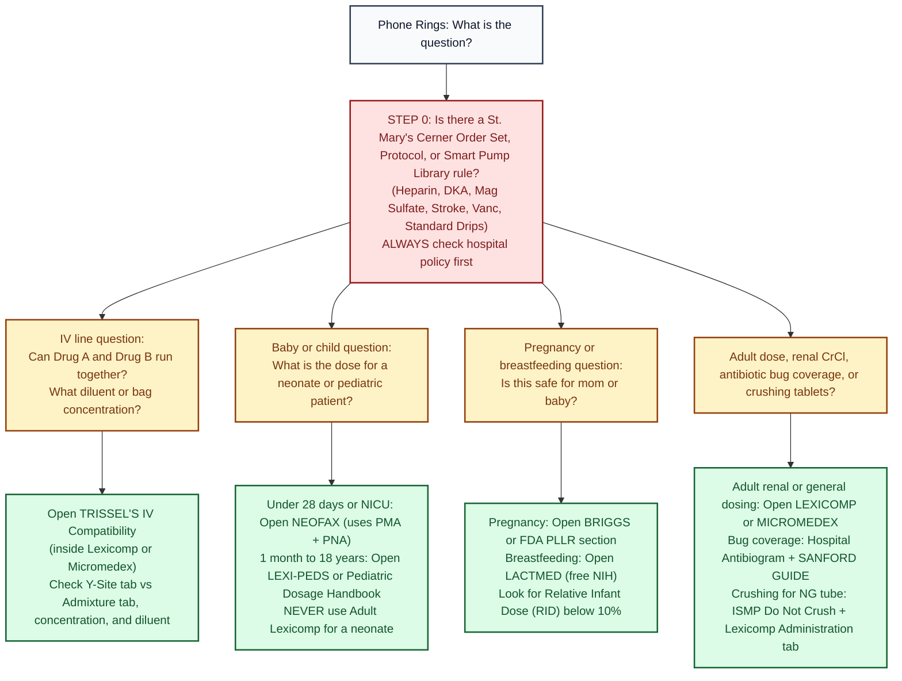

# Drug Information Hub

Her own references, organized by the job each one does. Content comes from public, citable sources. Every dose is marked ✅✅ (two sources), ✅ (one source) or ⚠️ [VERIFY], and every page lists its source links.

## Sections
| Section | Does the job of | Status |
|---|---|---|
| Drug Monographs | Lexicomp or Micromedex type reference | Pilot complete: 10 high alert drugs |
| [[IV_Compatibility]] | Trissel's or King Guide type reference | Built: diluents, lines, filters, containers, extravasation |
| [[Antimicrobial_Guide]] | Sanford type guide | Built: pneumonia, UTI, skin, meningitis, C. diff |
| [[Pediatric_Neonatal_Dosing]] | pediatric dosage handbook or Neofax type reference | Built: 6 checks, everyday doses, neonatal sepsis antibiotics |
| [[Pregnancy_Lactation]] | Briggs type reference | Built: PLLR, relative infant dose, L&D and postpartum quick answers |

## Pilot list (high alert drugs first)
1. [[Heparin]] (done)
2. [[Enoxaparin]] (done)
3. [[Insulin_IV_DKA]] (done)
4. [[Magnesium_Sulfate]] (done)
5. [[Potassium_Chloride_IV]] (done)
6. [[Vancomycin]] (done)
7. [[Gentamicin]] (done)
8. [[Norepinephrine]] (done)
9. [[Thrombolytics_Stroke]] (done)
10. [[4F_PCC]] (done)

## Free references to open directly
| Need | Link |
|---|---|
| Official FDA label | [DailyMed](https://dailymed.nlm.nih.gov/dailymed/) |
| Approvals, label history | [Drugs@FDA](https://www.accessdata.fda.gov/scripts/cder/daf/) |
| Generic equivalence | [Orange Book](https://www.accessdata.fda.gov/scripts/cder/ob/) |
| Literature | [PubMed](https://pubmed.ncbi.nlm.nih.gov/) |
| Lactation | [LactMed (NIH)](https://www.ncbi.nlm.nih.gov/books/NBK501922/) |
| QT risk | [CredibleMeds](https://crediblemeds.org/) |
| IV stability (free) | [Stabilis](https://www.stabilis.org/) |
| High alert and Do Not Crush lists | [ISMP](https://www.ismp.org/) |
| Hazardous drugs | [NIOSH list](https://www.cdc.gov/niosh/healthcare/hazardous-drugs/) |
| Shortages | [ASHP Drug Shortages](https://www.ashp.org/drug-shortages/current-shortages) |
| Calculators | [MDCalc](https://www.mdcalc.com/) |
| Poison Control | 1 800 222 1222 |

## Subscription references (use through St. Mary's or Pyrls)
Lexicomp, Micromedex (includes Poisindex), Trissel's, King Guide, Sanford Guide, pediatric and neonatal dosage handbook or Neofax, Briggs, Natural Medicines, UpToDate, [Pyrls](https://app.pyrls.com/home).

---

## Which reference do I open in 10 seconds when the phone rings?

### The Golden Rule of Hospital Pharmacy: Hospital Protocol Beats the Textbook
Before you quote Lexicomp or UpToDate to a physician or nurse, **always check St. Mary's Cerner Order Set, Hospital Policy, or Smart Pump Library first** (see [[Stay_Current]]).
- **Why:** If Lexicomp lists three ways to dose a heparin drip, DKA insulin drip, magnesium sulfate, or vancomycin AUC, you must verify against the exact nomogram and standard bag concentration built into St. Mary's smart pumps. Using an outside concentration that does not match the pump library creates a high risk medication error (ISMP High Alert Medications 2024).

*Sources: ISMP Targeted Medication Safety Best Practices 2024; ASHP Guidelines on Providing Drug Information; [[IV_Compatibility]], [[Pediatric_Neonatal_Dosing]], and [[Pregnancy_Lactation]].*

---

## Side by side guide: Trissel's vs Lexicomp vs NeoFax vs Sanford vs Briggs

| Resource | When to open it first | What trap to watch out for (Plain English) |
|---|---|---|
| **Trissel's IV Compatibility** (accessed via the *IV Compatibility* tab in Lexicomp or Micromedex) | Nurse asks: *"Can I Y-site vancomycin with piperacillin tazobactam?"* or *"How long is this diluted bag stable?"* | **Check the right tab and concentration:** • **Y-Site tab:** Two separate bags meeting at the tubing port near the patient (only mixes for a few minutes in the line). • **Admixture (Solution) tab:** Mixed together inside the same IV bag for hours. • **Concentration matters:** Ampicillin is stable much longer in NS than D5W, and high concentrations precipitate faster. Vancomycin and beta lactams can precipitate at certain concentrations. • **"Variable" or "No Data":** Click into the study details. If your patient's concentration is higher than the tested concentration, or if there is no data, treat as **Incompatible** and flush the line with NS between drugs or use a separate lumen (see [[IV_Compatibility]]). |
| **Lexicomp (Adult) vs Micromedex** | Every routine adult verification: renal CrCl adjustments, hepatic adjustments, black box warnings, max daily doses, administration rates, and drug interactions. | **How to use them together:** • **Lexicomp** is fastest at the bench for clean dosing by indication, CrCl cutoffs, and administration rate (push vs piggyback). • **Micromedex** is your tie breaker when Lexicomp is vague, when you need deeper toxicology (**Poisindex**), or when checking detailed **Trissel's** solution stability tables. |
| **NeoFax vs Lexi-Peds (Taketomo Pediatric Handbook)** | **NeoFax:** Any baby in the NICU or under 28 days old. **Lexi-Peds:** Infants over 28 days, children, and adolescents in PICU or general pediatrics. | **Never use Adult Lexicomp for a baby:** • Premature babies clear drugs slowly because their kidneys and liver are still developing. • **NeoFax** doses by **Gestational Age (GA)** or **Postmenstrual Age (PMA = GA + weeks since birth)** plus **Postnatal Age (PNA = days since birth)** (for example, NICU gentamicin every 24, 36, or 48 hours; see [[NICU_Core]]). • **Lexi-Peds** gives weight based `mg/kg` dosing **and** the adult ceiling cap (never exceed the adult dose in a heavy teenager; see [[Pediatric_Neonatal_Dosing]]). |
| **St. Mary's Antibiogram + Sanford Guide** | Doctor asks: *"What empiric antibiotic should we start for this ICU pneumonia or urosepsis?"* or *"Does oral step down work here?"* | **Local resistance beats national averages:** • **Sanford Guide** tells you which bugs a drug covers in general and gives clean renal antibiotic dosing tables. • **St. Mary's Antibiogram** tells you what percentage of local *Pseudomonas*, *E. coli*, or *MRSA* at St. Mary's is actually susceptible this year (see [[ID_Core]] and [[Antimicrobial_Guide]]). |
| **Briggs (Pregnancy) & LactMed (Breastfeeding)** | OB nurse or physician asks: *"Can this mom take labetalol, enoxaparin, or sertraline while pregnant or breastfeeding?"* | **Letters A, B, C, D, X are gone:** • The FDA replaced pregnancy letter categories with the **PLLR** narrative (Risk Summary, Clinical Considerations, Data). Use **Briggs** or the FDA label PLLR section for pregnancy. • For breastfeeding, open **LactMed (NIH, free)** and check the **Relative Infant Dose (RID)**: an **RID below 10%** is generally considered compatible with breastfeeding for full term infants (see [[Pregnancy_Lactation]]). |
| **CredibleMeds + ISMP Lists** | Checking QT prolongation stacking (ondansetron + haloperidol + azithromycin + methadone) or whether a pill can be crushed for an NG/OG tube. | • **CredibleMeds** separates drugs that **clearly cause Torsades de Pointes** ("Known Risk") from drugs that only prolong QTc under certain conditions (check K above 4.0 and Mg above 2.0). • **ISMP Do Not Crush** (and Lexicomp's *Administration* section) stops you from crushing extended release (`ER/XR`), enteric coated (`EC`), or hazardous tablets (see [[Med_Safety_and_Florida_Law]]). |

