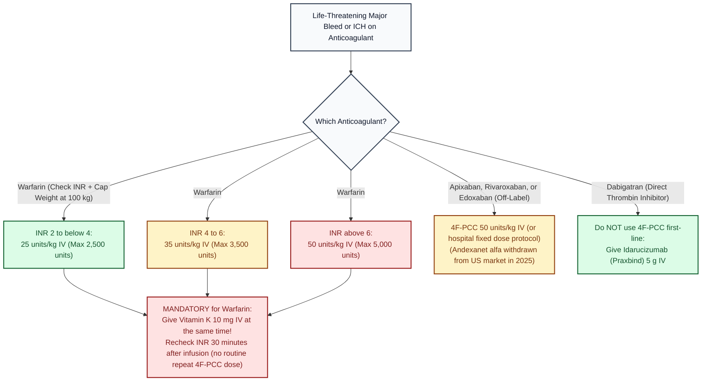

# 4 Factor Prothrombin Complex Concentrate (4F-PCC, Kcentra) · Drug Monograph

*Drug Monographs section. Built from public sources. Confirm against St. Mary's anticoagulant reversal order set.*
**Key:** ✅✅ two independent sources · ✅ one source · ⚠️ [VERIFY]

**Boxed warning:** arterial and venous thromboembolic events. Not studied in patients with a thromboembolic event in the prior 3 months ✅ [1].

## Warfarin reversal (labeled use), with vitamin K
| Pre treatment INR | Dose (units of factor IX per kg) | Max | Check | Sources |
|---|---|---|---|---|
| 2 to below 4 | 25 units/kg | 2,500 units | ✅✅ | [1] label; [2] Children's Mercy guideline |
| 4 to 6 | 35 units/kg | 3,500 units | ✅✅ | [1][2] |
| above 6 | 50 units/kg | 5,000 units | ✅✅ | [1][2] |

- Dose by weight up to **100 kg**; don't exceed the max above 100 kg ✅ [1].
- **Give vitamin K at the same time** (4F-PCC wears off before warfarin does) ✅✅ [1][2]. Adult major bleeding: vitamin K 10 mg IV ✅ (AHA/ASA ICH 2022, see [[Stroke_Core]]).
- Infusion: 0.12 mL/kg/min (about 3 units/kg/min), max 8.4 mL/min ✅ [1].
- **Repeat dosing is not recommended** by the label ✅ [1].
- Check INR about 30 minutes after the infusion ✅ [2].

## Factor Xa inhibitor bleeding (apixaban, rivaroxaban, edoxaban), off label
- 4F-PCC 50 units/kg per many protocols (some use fixed doses such as 2,000 units) ⚠️ [VERIFY St. Mary's protocol].
- Andexanet alfa was withdrawn from the US market in 2025, so 4F-PCC is the main option ✅ (see [[Stroke_Core]]).
- Dabigatran: idarucizumab 5 g IV is the specific reversal agent ✅ (see [[Stroke_Core]]).

## Visual decision ladder: 4F-PCC (Kcentra) reversal by INR and anticoagulant type

*Sources: Kcentra prescribing information [1]; Children's Mercy Warfarin Antidotes guideline [2]; [[Stroke_Core]] (AHA/ASA ICH 2022).*

## Plain English memory guide: Mechanism, body timing, and "why never"

| Concept | Plain English picture | Clinical rule on shift |
|---|---|---|
| **How it works (Mechanism)** | Warfarin starves the liver so it cannot finish making the **4 vitamin K dependent clotting factors (`Factors II, VII, IX, and X`: think "1972")**. Fresh Frozen Plasma (`FFP`) requires thawing and pouring liters of fluid into the patient. **4F-PCC (Kcentra) is "instant concentrated clotting factors in a small vial"**: it hands the patient ready made **Factors II, VII, IX, and X** (plus Proteins C and S) in minutes. | Dosing is always written in **units of Factor IX per kg**, and dosing weight is **capped at 100 kg** ✅ [1][2]. |
| **How long it takes in the body (Body Timing)** | • **4F-PCC onset:** Drops the INR below 1.4 within **30 minutes** of finishing the infusion ✅ [1][2]. • **Why it wears off:** **Factor VII** inside the 4F-PCC vial has a half life of only **4 to 6 hours**, whereas **warfarin** lasts **2 to 5 days**. • **Vitamin K IV onset:** Takes **4 to 6 hours** for the liver to start building its own fresh clotting factors, and **12 to 24 hours** for full effect. | **Why you MUST give Vitamin K 10 mg IV at the exact same time as 4F-PCC:** 4F-PCC is the **parachute** for the first 6 hours; **IV Vitamin K** builds the **bridge** at hour 6 so the INR does not rebound back up to 5.0 that night ✅ [1][2]. |
| **Why NEVER forget the 100 kg weight cap, and why NEVER give repeat doses** | • **Why cap weight at 100 kg:** Clotting factors stay inside the bloodstream (plasma volume does not double just because a patient weighs 150 kg). Dosing above 100 kg or giving repeat doses causes fatal **arterial and venous blood clots (stroke, PE, MI: Boxed Warning)** ✅ [1]. • **Contains heparin:** Kcentra vials contain a small amount of **heparin**; it is **contraindicated in patients with a history of HIT** ✅ [1]. | Always cap calculation weight at **100 kg** (`max 2,500 / 3,500 / 5,000 units`), pair with **Vitamin K 10 mg IV**, check HIT history, and recheck INR **30 minutes** after infusion ✅ [1][2]. |

## Pharmacist checklist
1. Which anticoagulant, and when was the last dose?
2. Current INR and weight (cap at 100 kg).
3. Vitamin K ordered with it for warfarin.
4. Any thrombosis in the last 3 months? Weigh the risk.
5. INR 30 minutes after; no routine repeat dose.

## Sources
1. [Kcentra prescribing information (Drugs.com)](https://www.drugs.com/pro/kcentra.html)
2. [Children's Mercy Kansas City: Warfarin antidotes clinical practice guideline](https://www.childrensmercy.org/health-care-providers/evidence-based-practice/clinical-practice-guidelines/anticoagulation-therapy-warfarin-therapy/warfarin-antidotes/)

*Last verified: 2026-10-17.*
