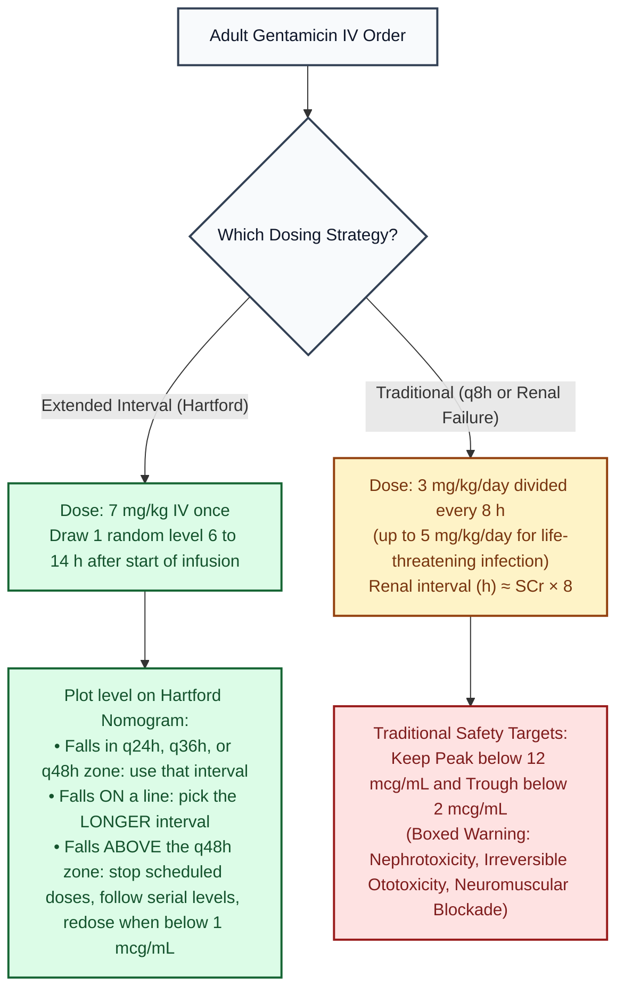

# Gentamicin (IV) · Drug Monograph

*Drug Monographs section. Built from public sources. Confirm against St. Mary's aminoglycoside protocol.*
**Key:** ✅✅ two independent sources · ✅ one source · ⚠️ [VERIFY]

**Boxed warning:** nephrotoxicity, usually irreversible ototoxicity (vestibular and hearing), neuromuscular blockade; avoid other nephrotoxic or neurotoxic drugs and potent loop diuretics; fetal harm ✅ [1].

## Adult dosing
| Approach | Dose | Check | Sources |
|---|---|---|---|
| Traditional (label) | 3 mg/kg/day divided every 8 h; up to 5 mg/kg/day for life threatening infection, then back to 3 | ✅ | [1] |
| Traditional targets | Avoid peaks above 12 mcg/mL and troughs above 2 mcg/mL | ✅ | [1] |
| Renal (label method) | Interval (h) ≈ SCr × 8, or divide dose by SCr for every 8 h dosing | ✅ | [1] |
| Hemodialysis | 1 to 1.7 mg/kg after dialysis | ✅ | [1] |
| **Extended interval (Hartford)** | **7 mg/kg**; one random level; plot on the nomogram for every 24, 36 or 48 h | ✅✅ | [2] Nicolau 1995; [3] nomogram guide |
| Hartford rules | Only valid for 7 mg/kg; assumes Vd 0.3 L/kg; level above the q48h zone means stop scheduled doses, follow serial levels and redose when below 1 mcg/mL; on a line, pick the longer interval | ✅ | [3] |
| Level timing for Hartford | 6 to 14 h after the start of the dose | ⚠️ | [VERIFY original paper] |
| Weight for dosing | Actual weight, or adjusted weight in obesity per protocol | ⚠️ | [VERIFY St. Mary's] |

## Pediatrics and neonates (label)
- Neonates 1 week old or younger: 2.5 mg/kg every 12 h. Infants: 2.5 mg/kg every 8 h. Children: 2 to 2.5 mg/kg every 8 h ✅ [1].
- Most NICUs use extended interval dosing by gestational and postnatal age instead (see [[NICU_Core]]) ⚠️ [VERIFY unit chart].

## Visual decision ladder: Gentamicin Extended Interval (Hartford `7 mg/kg`) vs Traditional dosing

**Do not use the Hartford nomogram in these patients** (they were excluded from the original study, so use traditional dosing or individualized kinetics): pregnancy, burns over 20% of body surface, ascites or large fluid shifts, CrCl below 20 mL/min or dialysis, endocarditis or synergy dosing, cystic fibrosis, children, and major obesity without a dosing weight adjustment ✅ [2] ⚠️ check St. Mary's aminoglycoside protocol.

*Sources: Gentamicin FDA label (DailyMed) [1]; Nicolau 1995 Hartford nomogram [2]; Bugs and Drugs Hartford guide [3].*

## Plain English memory guide: Mechanism, body timing, and "why never"

| Concept | Plain English picture | Clinical rule on shift |
|---|---|---|
| **How it works (Mechanism)** | Gentamicin sneaks inside aerobic Gram negative bacteria (using an **oxygen powered** door) and locks onto the **30S ribosome**, forcing the bacteria to print scrambled, toxic proteins until the cell dies. **Why one big dose works (`7 mg/kg`):** It is **concentration dependent** (higher peak = faster kill) and has a **post antibiotic effect** (bacteria stay stunned for hours even after serum gentamicin drops to zero). | Giving **one large dose (`7 mg/kg`)** gets a high peak to kill Gram negative rods, and then gives the kidneys and inner ear a **drug free holiday** for the second half of the day ✅ [2][3]. |
| **How long it takes in the body (Body Timing)** | • **Distribution (`Vd ≈ 0.3 L/kg` in adults, larger in neonates):** Stays mostly in extracellular water ✅ [3]. • **Elimination:** Cleared **100% unchanged by the kidneys**. | Why low troughs (`< 2 mcg/mL` traditional, or drug free interval on Hartford) save the kidneys and ears: kidney proximal tubule cells and inner ear hair cells **saturate** when they take up gentamicin; they only get poisoned when the drug sits around continuously **24 hours a day** without a trough holiday ✅ [1][2]. |
| **Why NEVER use Hartford nomogram for a 3 mg/kg dose, and why gentamicin NEVER kills anaerobes alone** | • **Never plot a non 7 mg/kg dose on the Hartford chart:** The Hartford nomogram lines were mathematically drawn **only for a `7 mg/kg` dose**; plotting a `5 mg/kg` or `3 mg/kg` level on that graph gives a completely wrong interval ✅ [3]. • **Why it never covers anaerobes:** The door that pulls gentamicin inside a bacterium requires **oxygen**; anaerobic bacteria don't use oxygen, so gentamicin is locked out. | Always verify that a Hartford level came from a **`7 mg/kg`** dose drawn between **6 and 14 hours** after the start of the infusion, and avoid stacking loop diuretics or other nephrotoxins ✅ [1][3]. |

## Pharmacist checklist
1. Which method: traditional or extended interval?
2. Weight (actual vs adjusted), SCr and urine output.
3. Level ordered at the right time.
4. Avoid with other nephrotoxins where possible; baseline hearing complaints.
5. Duration: label usual 7 to 10 days ✅ [1].

## Sources
1. [FDA label, Gentamicin Injection USP 40 mg/mL (DailyMed)](https://dailymed.nlm.nih.gov/dailymed/fda/fdaDrugXsl.cfm?setid=09cf88af-59da-f147-e063-6294a90aac99)
2. [Nicolau DP, et al. Once daily aminoglycoside program in 2,184 adults. Antimicrob Agents Chemother 1995;39:650-655](https://doi.org/10.1128/AAC.39.3.650) · summary: [Record](https://www.qxmd.com/r/7793867)
3. [Bugs and Drugs: Interpretation of aminoglycoside interval level, Hartford nomogram](https://bugsanddrugs.org/FA5428C4-4A03-4175-B670-55FF25DDBCB1)

*Last verified: 2026-10-17.*
