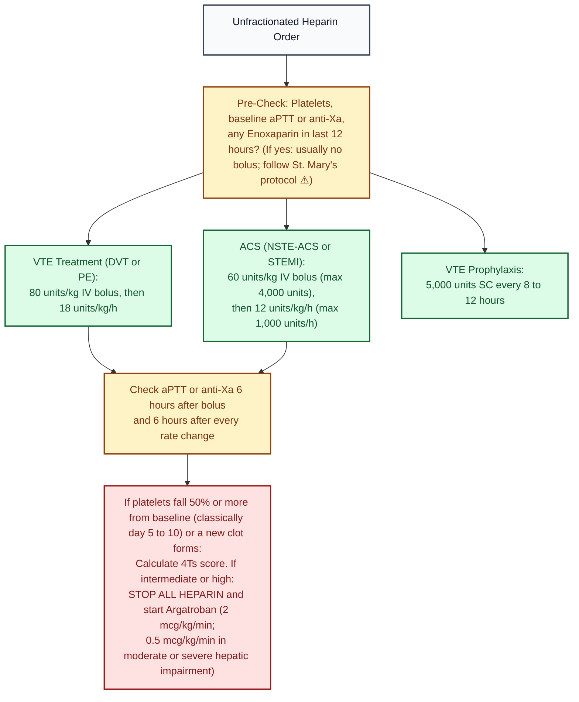

# Heparin (unfractionated) · Drug Monograph

*Drug Monographs section (does the job of a general drug reference such as Lexicomp or Micromedex). Built from public sources. Confirm against St. Mary's protocol and the hospital's drug reference before clinical use.*

**Verification key:** ✅✅ confirmed in two independent sources · ✅ one source · ⚠️ [VERIFY] not yet confirmed twice

ISMP High Alert Medication. Independent double check per St. Mary's policy.

---

## Quick card
| Item | Value | Check | Sources |
|---|---|---|---|
| VTE treatment (weight based) | 80 units/kg IV bolus, then 18 units/kg/h; adjust by nomogram | ✅✅ | [1] Raschke 1993; [2] WikEM summary of StatPearls |
| ACS (NSTE-ACS, STEMI with fibrinolysis) | 60 units/kg bolus (max 4,000 units), then 12 units/kg/h (max 1,000 units/h) | ✅✅ | [3] ESC/ACC/AHA dosing as summarized by Termedia review; [4] hospital ACS heparin order set (Southern Health) |
| PCI | 70 to 100 units/kg bolus (50 to 70 units/kg with a GP IIb/IIIa inhibitor), ACT guided | ⚠️ | [3] gives 100 units/kg (60 with GP IIb/IIIa) [VERIFY current ACC/AHA PCI wording] |
| VTE prophylaxis | 5,000 units SC every 8 to 12 hours | ✅✅ | [Comparative Effectiveness Research: UFH prophylaxis review](https://becarispublishing.com/doi/full/10.2217/cer.14.78); [InfoPOEMs: UFH q8h vs q12h meta analysis (King, Chest 2007)](https://evidence.unboundmedicine.com/evidence/pview/infoPOEMs/426123/all/Optimal%20dosing%20for%20thromboprophylaxis%20in%20medical%20inpatients) (q8h may prevent slightly more clots but bleeds more) |
| Label continuous infusion (fixed dosing) | 5,000 unit IV bolus, then 20,000 to 40,000 units/24 h | ✅ | [5] FDA label (DailyMed) |
| Monitoring target | aPTT 1.5 to 2 times control (label) or per hospital anti Xa range | ✅ | [5] label; anti Xa 0.3 to 0.7 units/mL commonly used ⚠️ [VERIFY St. Mary's] |
| Monitoring timing | aPTT 6 hours after bolus and after each rate change, then daily when therapeutic | ✅ | [4] |
| Platelets | Check periodically; stop if below 100,000 or new thrombosis (suspect HIT) | ✅ | [5] |
| Potassium | Heparin can raise K (aldosterone suppression); check if at risk or therapy over 5 days | ✅ | [5] |
| Reversal | Protamine about 1 mg per 100 units of heparin given (consider heparin's 30 to 90 minute half life); max 50 mg in any 10 minutes | ✅✅ | [5] label; [6] premixed heparin label (Baxter) |
| Neonates and infants | Use **preservative free** heparin (benzyl alcohol causes gasping syndrome) | ✅ | [5] |
| Pediatric treatment dosing | Load 75 to 100 units/kg, then about 28 units/kg/h (infants) or 20 units/kg/h (over 1 year) | ⚠️ | [VERIFY CHEST pediatric antithrombotic guideline and St. Mary's pediatric protocol] |

## Visual decision ladder: Heparin indication, dosing, and HIT safety

*Sources: Raschke 1993 [1]; ESC/ACC/AHA ACS summary [3]; Southern Health ACS order set [4]; FDA label [5]; ASH 2018 HIT guideline [7]; Argatroban FDA label 2019 [8].*

## Plain English memory guide: Mechanism, body timing, and "why never"

| Concept | Plain English picture | Clinical rule on shift |
|---|---|---|
| **How it works (Mechanism)** | Think of **Antithrombin III** as the body's natural police officer that handcuffs clotting factors (**Factor IIa [thrombin]** and **Factor Xa**). By itself, Antithrombin walks slowly. **Unfractionated heparin** straps a jetpack onto Antithrombin so it handcuffs clotting factors **1,000 times faster**. Because unfractionated heparin has a long sugar tail, it can wrap around **both** Factor Xa and Factor IIa. | Because it blocks thrombin immediately, it stops existing clots from growing right away while the body dissolves them ✅ [5]. |
| **How long it takes in the body (Body Timing)** | • **IV bolus onset:** Immediate. • **Half life:** **30 to 90 minutes** (dose dependent: higher doses saturate clearance and last longer) ✅ [5][6]. • **Steady state after rate change:** **6 hours** ✅ [4]. | That 30 to 90 minute half life is why surgeons love IV heparin in the ICU (turn the pump off and the effect fades in a few hours) and why you **check aPTT or anti Xa 6 hours after every rate change** ✅ [4][5]. |
| **Why NEVER bolus after recent Enoxaparin, and why NEVER give benzyl alcohol vials to babies** | • **No bolus on top of Enoxaparin:** If the patient received treatment dose enoxaparin within the last 12 hours, their Factor Xa is already blocked; giving a full heparin bolus on top causes major hemorrhage ✅ [4]. • **No benzyl alcohol in neonates:** Multi dose heparin vials preserved with benzyl alcohol cause fatal neonatal **gasping syndrome** (metabolic acidosis and respiratory collapse) ✅ [5]. • **Why heparin raises K+:** Heparin suppresses **aldosterone** in the adrenal gland after several days, causing the kidneys to hold onto potassium ✅ [5]. | Always check the MAR for prior enoxaparin before verifying a heparin bolus, always use **preservative free** syringes in neonates, and watch serum K+ when therapy runs over 5 days ✅ [4][5]. |

## Safety (why it's high alert)
- **Look alike strengths:** 1,000, 5,000 and 10,000 units/mL vials look alike. Fatal pediatric hemorrhages have happened when 1 mL heparin vials were confused with 1 mL catheter lock flush vials (FDA label section 5.1) ✅ [5].
- Use premixed bags and smart pump libraries for infusions.
- Contraindicated with a history of HIT, uncontrolled active bleeding (except DIC), and when coagulation tests can't be done at appropriate intervals ✅ [5].

## Heparin induced thrombocytopenia (HIT)
- Use the **4Ts score** to estimate pretest probability; with a **low** 4Ts score, don't send HIT testing and don't treat empirically (strong recommendation) ✅ [7] ASH 2018.
- If HIT is suspected (intermediate or high 4Ts): **stop all heparin** (including flushes and heparin coated catheters) and start a non heparin anticoagulant: argatroban, bivalirudin, fondaparinux or a DOAC (conditional) ✅ [7].
- **Argatroban:** 2 mcg/kg/min; **0.5 mcg/kg/min in moderate or severe hepatic impairment**; max 10 mcg/kg/min; aPTT 1.5 to 3 times baseline (not above 100 seconds), check 2 hours after starting or changing ✅ [8] FDA label.
- **Warfarin overlap with argatroban:** no loading dose; stop argatroban when INR is above 4 on combined therapy (at argatroban 2 mcg/kg/min or less), recheck INR in 4 to 6 hours ✅ [8].
- Start warfarin only after platelets recover (at least 150,000), with overlap; ASH 2018 prefers a DOAC when appropriate; treat 3 to 6 months with thrombosis, about 4 to 6 weeks without ✅ [The Blood Project: switching off argatroban in HIT (ASH 2018)](https://www.thebloodproject.com/ufaq/in-a-patient-with-hit-when-can-i-stop-iv-argatroban-or-bivalirudin-what-do-i-switch-to-and-for-how-long/).

## Pharmacist verification checklist
1. Indication and the right nomogram (VTE vs ACS vs low intensity).
2. Dosing weight (actual body weight; know St. Mary's cap for obesity).
3. Baseline aPTT or anti Xa, CBC, platelets, SCr.
4. Any enoxaparin in the last 12 hours? (Don't bolus) ✅ [4]
5. Concentration and bag match the pump library.
6. Lab draw times ordered.

## Sources (open these to verify)
1. [Raschke RA, et al. Weight based heparin dosing nomogram. Ann Intern Med 1993;119:874-881](https://doi.org/10.7326/0003-4819-119-9-199311010-00002) · summary: [University of Arizona record](https://experts.arizona.edu/en/publications/the-weight-based-heparin-dosing-nomogram-compared-with-a-standard/)
2. [WikEM: Unfractionated heparin](https://wikem.org/wiki/Unfractionated_heparin) (secondary summary; cites StatPearls)
3. [Termedia: Anticoagulation therapy in acute coronary syndromes according to current guidelines](https://termedia.pl/Acute-management-of-ACS-Anticoagulation-therapy-in-acute-coronary-syndromes-according-to-current-guidelines,52,14059,1,1.html)
4. [Southern Health: Heparin Infusion Standard Orders, Acute Coronary Syndrome](https://staffnet.southernhealth.ca/wp-content/uploads/Heparin-Infusion-Standard-Orders-Acute-Coronary-Syndrome.pdf)
5. [FDA label, Heparin Sodium Injection USP (DailyMed)](https://dailymed.nlm.nih.gov/dailymed/fda/fdaDrugXsl.cfm?setid=45dc6b8b-ed5d-40a2-8d9c-084c863ae93a&type=display)
6. [FDA label, Heparin Sodium in 0.9% Sodium Chloride, Baxter (DailyMed)](https://dailymed.nlm.nih.gov/dailymed/getFile.cfm?setid=0d929726-76c3-48fc-b4e7-fd06409f9fb3&type=pdf&name=0d929726-76c3-48fc-b4e7-fd06409f9fb3)
7. [Cuker A, et al. ASH 2018 guidelines: heparin induced thrombocytopenia. Blood Adv 2018;2:3360-3392](https://doi.org/10.1182/bloodadvances.2018024489) · summary: [McMaster record](https://experts.mcmaster.ca/scholarly-works/1612254) · [PubMed](https://pubmed.ncbi.nlm.nih.gov/30482768/)
8. [FDA label, Argatroban Injection (2019)](https://www.accessdata.fda.gov/drugsatfda_docs/label/2019/022485s013lbl.pdf)

**Pyrls:** search "heparin" in Drug Summaries.

*Last verified: 2026-10-17.*
