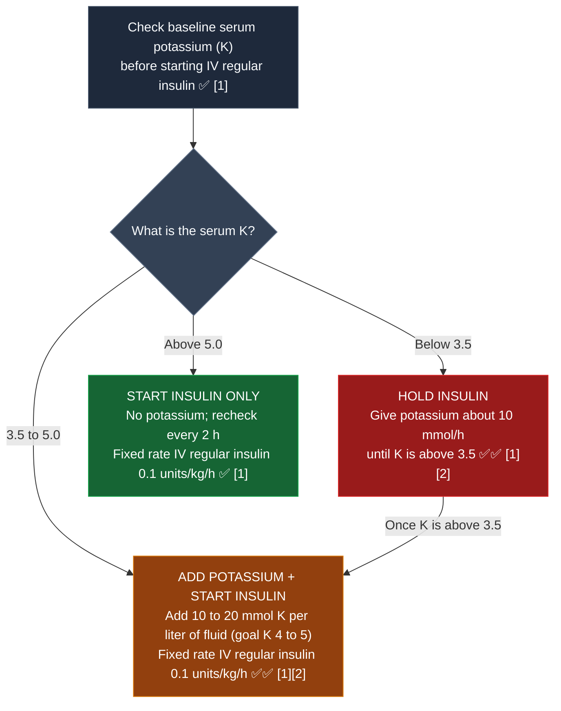
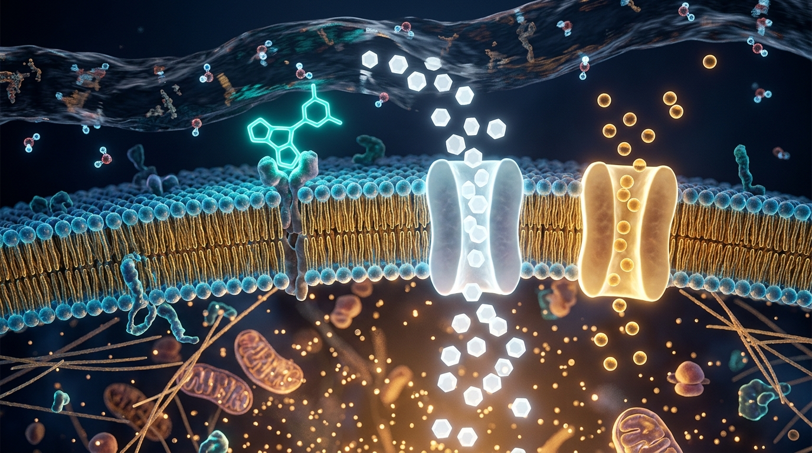

# Insulin, IV (DKA and HHS, adults) · Drug Monograph

*Drug Monographs section. Built from public sources. Confirm against St. Mary's DKA order set before clinical use.*
**Key:** ✅✅ two independent sources · ✅ one source · ⚠️ [VERIFY]

ISMP High Alert Medication. Use the standard concentration in the smart pump library and an independent double check.

## DKA diagnosis (2024 consensus)
All three: **D** glucose 200 mg/dL or higher, or known diabetes at any glucose (catches euglycemic DKA on SGLT2 inhibitors); **K** beta hydroxybutyrate 3.0 mmol/L or higher (or urine ketones 2+); **A** pH below 7.3 and/or bicarbonate below 18 ✅✅ [1][2].

## Dosing
| Item | Recommendation | Check | Sources |
|---|---|---|---|
| Severe DKA | Fixed rate IV regular insulin 0.1 units/kg/h; no routine bolus (0.1 units/kg bolus only if IV access is delayed) | ✅✅ | [1][2] |
| HHS | 0.05 units/kg/h (treat as DKA if ketotic or acidotic) | ✅✅ | [1][2] |
| **Potassium below 3.5** | **Hold insulin.** Give potassium about 10 mmol/h until K is above 3.5 | ✅✅ | [1][2] |
| Potassium 3.5 to 5.0 | Add 10 to 20 mmol K per liter of fluid; goal K 4 to 5 | ✅✅ | [1][2] |
| Potassium above 5.0 | No potassium; recheck every 2 h | ✅ | [1] |
| Glucose below 250 | Add D5 or D10; lower DKA insulin to 0.05 units/kg/h; keep insulin running until ketones clear | ✅✅ | [1][2] |
| Glucose goal during DKA treatment | 150 to 200 mg/dL (HHS 200 to 250) | ✅ | [1] |
| Mild or uncomplicated moderate DKA | SC rapid acting insulin every 1 to 2 h is an accepted alternative | ✅✅ | [1][2] |

**Change from older teaching:** the 2009 statement used K 3.3 as the cutoff and allowed a 0.1 units/kg bolus. The 2024 consensus uses **3.5** and no routine bolus ✅ [1]. Pediatric DKA follows ISPAD 2022 (see [[PICU_Core]]).

### Potassium decision path before starting insulin

*Sources: Umpierrez GE et al., Diabetes Care 2024 consensus report [1][2] ✅✅*

## How it works in the body (plain English for fast recall)
- **Why potassium comes before insulin (the two door rule):** Think of insulin as a key that opens two doors on every cell at the same time: one door pulls sugar (glucose) out of the blood into the cell, and a second door (the sodium potassium pump) pulls potassium out of the blood into the cell. In DKA, acid in the blood has pushed potassium out of the cells, and high urine output has washed potassium out of the body. If serum potassium is already **below 3.5** and you turn on an insulin drip, insulin pushes the remaining potassium out of the blood into the cells, and serum potassium drops to a level that can cause dangerous heart rhythms. That is why you **hold insulin** and give potassium (about 10 mmol/h) until K is above 3.5 ✅✅ [1][2].
- **Why you add dextrose when glucose falls below 250 (clear the acid, not just the sugar):** Blood glucose drops much faster than blood ketones (acid) clear. When glucose reaches **below 250 mg/dL**, do **not** turn off the insulin drip, because the body still needs insulin to shut off ketone production. Instead, add **D5 or D10** to the IV fluids to prevent hypoglycemia and lower the DKA insulin drip to **0.05 units/kg/h** until ketones clear ✅✅ [1][2].
- **Timing in the body (why basal insulin goes in 1 to 2 hours before stopping the drip):** IV regular insulin starts working within minutes, and once you stop the pump its effect fades within 30 to 60 minutes. Subcutaneous basal insulin takes **1 to 2 hours** to absorb and take over. Giving subcutaneous basal insulin at least **1 to 2 hours before** stopping the IV drip prevents a gap with zero insulin in the body, which would let ketone production rebound ✅✅ [1][2].

## Fluids
Isotonic saline or balanced crystalloid 500 to 1,000 mL/h for 2 to 4 h if heart and kidneys allow; smaller boluses in older adults and heart or kidney failure ✅ [1].

## Resolution and transition
- DKA resolved: beta hydroxybutyrate below 0.6 mmol/L **and** pH 7.3 or higher or bicarbonate 18 or higher ✅ [1].
- Give **basal insulin at least 1 to 2 hours before stopping the drip** ✅✅ [1][2]. Estimate total daily dose 0.3 to 0.6 units/kg/day ✅✅ [1][2].

## Monitoring
K at baseline, 2 h after insulin starts, then every 4 h; glucose hourly ✅ [1].

## Pharmacist checklist
1. K result before insulin starts.
2. No bolus unless IV delay.
3. Dextrose added at glucose below 250.
4. SGLT2 inhibitor on home list? Hold it.
5. Basal insulin ordered 1 to 2 h before the drip stops.

## Sources
1. Rodriguez Alvarez P, et al. [Hyperglycemic crises in adults: a look at the 2024 consensus report. Cleve Clin J Med. 2025;92(3):152-158](https://www.ccjm.org/content/92/3/152.full.pdf). Summarizes Umpierrez GE, et al. Diabetes Care. 2024;47(8):1257-1275 (doi:10.2337/dci24-0032).
2. [Cleveland Clinic Consult QD: Hyperglycemic crises in adults, the 2024 consensus report](https://consultqd.clevelandclinic.org/hyperglycemic-crises-in-adults-the-2024-consensus-report)

*Last verified: 2026-10-17.*
