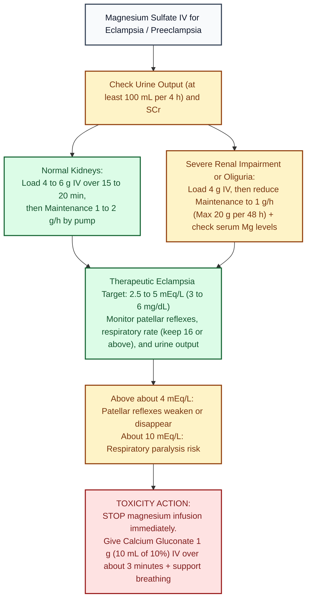

# Magnesium Sulfate (IV) · Drug Monograph

*Drug Monographs section. Built from public sources. Confirm against St. Mary's L&D magnesium order set.*
**Key:** ✅✅ two independent sources · ✅ one source · ⚠️ [VERIFY]

ISMP High Alert Medication (IV magnesium). Use premixed bags and a dedicated pump channel.

## Preeclampsia and eclampsia
| Item | Dose | Check | Sources |
|---|---|---|---|
| Loading dose | 4 to 6 g IV over 15 to 20 minutes | ✅✅ | [1] label (over 15 min); [2] UT Southwestern 2026 (over 15 to 20 min) |
| Maintenance | 1 to 2 g/h by pump | ✅✅ | [1][2] |
| IM option | 10 g (5 g each buttock), then 5 g IM every 4 h | ✅ | [2] |
| Recurrent seizure on magnesium | Extra 2 g IV | ✅✅ | [1][2] |
| Daily maximum | 30 to 40 g per 24 h | ✅ | [1] |
| Duration | 24 h after delivery or last seizure; label: do not use beyond 5 to 7 days (fetal hypocalcemia, bone demineralization, neonatal fractures) | ✅✅ | [1][2] |
| **Severe renal impairment or oliguria** | 4 g load, then **1 g/h**, max **20 g per 48 h**; check serum levels | ✅ | [1] |

## Visual decision ladder: Magnesium dosing, renal adjustment, and toxicity thresholds

*Sources: Magnesium Sulfate in 5% Dextrose FDA label (Hospira 2019) [1]; UT Southwestern CME 2026 [2].*

## Plain English memory guide: Mechanism, body timing, and "why never"

| Concept | Plain English picture | Clinical rule on shift |
|---|---|---|
| **How it works (Mechanism)** | Calcium is the "spark" that makes nerves fire acetylcholine and muscles contract. **Magnesium is calcium's calm twin brother**: it sits inside the calcium channels at the neuromuscular junction and brain synapses so nerves stop misfiring into eclampsia seizures. | **Why Calcium Gluconate is the antidote:** When magnesium climbs too high and paralyzes the diaphragm, **1 g IV calcium gluconate** floods the synapse with calcium to push magnesium off the receptors so the patient can breathe again ✅ [1][2]. |
| **How long it takes in the body (Body Timing)** | • **IV loading dose (4 to 6 g over 15 to 20 min):** Reaches seizure preventing levels immediately. • **IM option:** Takes about 60 minutes for onset. • **Elimination:** **100% cleared by the kidneys** in the urine. | Because ONLY the kidneys clear magnesium, if **urine output drops below 100 mL over 4 hours** (or SCr rises), the maintenance drip will rapidly build up to toxic levels (`> 4 to 10 mEq/L`) ✅ [1][2]. |
| **Why NEVER push fast, why NEVER run over 5 to 7 days in pregnancy, and why NEVER give in myasthenia gravis** | • **Never push fast:** Rapid IV bolus causes severe flushing, hypotension, and cardiac conduction block. • **Never run past 5 to 7 days in pregnancy:** Pulls calcium out of the baby's developing bones, causing fetal hypocalcemia and neonatal bone fractures ✅ [1][2]. • **Never give in myasthenia gravis:** Those patients barely have working acetylcholine receptors; blocking calcium release triggers instant respiratory failure ✅ [1]. | Always infuse the loading dose over **15 to 20 minutes** on a dedicated pump channel, cap therapy at **24 hours postpartum**, and keep **calcium gluconate 1 g (10 mL of 10%)** at the bedside ✅ [1][2]. |

## Monitoring and toxicity
- Check patellar reflexes, respiratory rate (concern below about 16 per label), urine output (keep at least 100 mL per 4 h; stop if lower, especially with rising SCr), serum magnesium ✅✅ [1][2].
- Label levels: reflexes weaken above about **4 mEq/L**; respiratory paralysis risk at about **10 mEq/L** ✅ [1]. Eclampsia target per label 2.5 to 5 mEq/L (3 to 6 mg/dL) ✅ [1].
- **Antidote:** stop the infusion; calcium gluconate 1 g (10 mL of 10%) IV over about 3 minutes; support breathing. Have calcium at the bedside before starting ✅✅ [1][2].
- Contraindications: heart block or myocardial damage, myasthenia gravis ✅ [1]. Don't combine with nifedipine or terbutaline per label caution ✅ [1].
- Newborns of treated mothers may need resuscitation and calcium ✅ [1].

## Other uses (not in the preeclampsia label)
- Torsades de pointes or hypomagnesemic arrest: 1 to 2 g IV ✅ (see [[Codes_Resuscitation]]).
- Fetal neuroprotection before 32 weeks: per L&D protocol ⚠️ [VERIFY].
- Hypomagnesemia repletion: per St. Mary's electrolyte protocol ⚠️ [VERIFY].

## Sources
1. [FDA label, Magnesium Sulfate in 5% Dextrose Injection (Hospira, rev. 4/2019)](https://www.accessdata.fda.gov/drugsatfda_docs/label/2019/020488Orig1s024lbl.pdf)
2. [ACOG Practice Bulletin 222: Gestational hypertension and preeclampsia. Obstet Gynecol 2020;135:e237-e260](https://doi.org/10.1097/AOG.0000000000003891) · summary: [UT Southwestern CME: Hypertensive Disorders in Pregnancy (2026)](https://cme.utsouthwestern.edu/sites/default/files/course/2026-04/1045am_Hypertensive%20Disorders%20in%20Pregnancy_Ambia.pdf) (cites ACOG)

*Last verified: 2026-10-17.*
