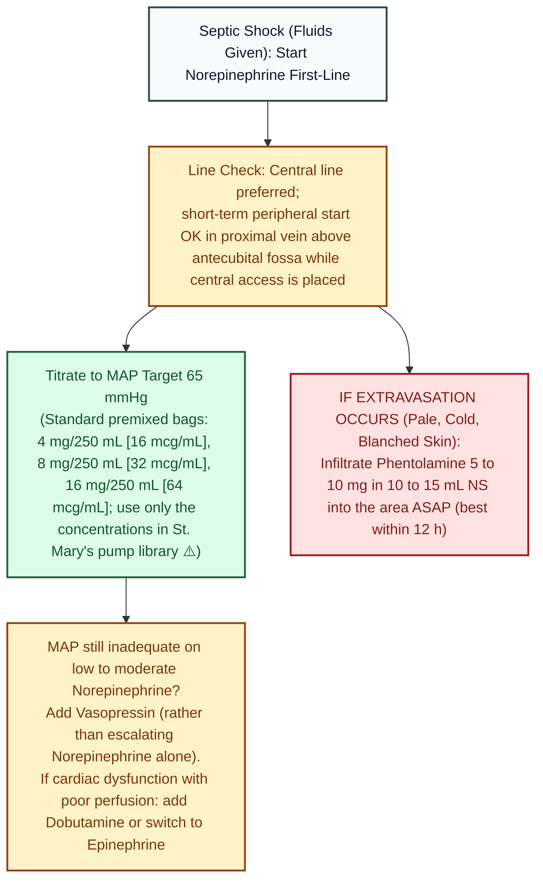

# Norepinephrine · Drug Monograph

*Drug Monographs section. Built from public sources. Confirm against St. Mary's vasopressor titration protocol and pump library.*
**Key:** ✅✅ two independent sources · ✅ one source · ⚠️ [VERIFY]

ISMP High Alert Medication (adrenergic agonist).

| Item | Recommendation | Check | Sources |
|---|---|---|---|
| Role in septic shock | First line vasopressor | ✅✅ | [2] SSC 2021; [3] SSC summary |
| MAP target | 65 mmHg | ✅✅ | [2][3] |
| Label starting rate | 8 to 12 mcg/min, then titrate; usual maintenance 2 to 4 mcg/min | ✅ | [1] |
| Weight based dosing (mcg/kg/min) | Many ICUs use it | ⚠️ | [VERIFY St. Mary's units] |
| Add vasopressin | When MAP is inadequate on low to moderate norepinephrine | ✅ | [2] |
| Peripheral start | Reasonable short term in a proximal vein above the antecubital fossa while central access is placed | ✅ | [2] |
| Cardiac dysfunction with poor perfusion | Consider adding dobutamine or switching to epinephrine | ✅ | [2] |
| **Extravasation** | Phentolamine 5 to 10 mg in 10 to 15 mL NS, infiltrated into the area as soon as possible (works best within 12 h) | ✅ | [1] |
| Premixed bags | 4 mg/250 mL (16 mcg/mL), 8 mg/250 mL (32 mcg/mL), 16 mg/250 mL (64 mcg/mL) in NS | ✅ | [1] |
| Infusion site | Large vein; avoid leg veins in elderly or vascular disease | ✅ | [1] |

## Drip math
At 16 mcg/mL, 5 mcg/min = 0.31 mL/min = **about 18.8 mL/h**. (See [[Codes_Resuscitation]] and IV prep notes.)

## Visual decision ladder: Norepinephrine septic shock titration and extravasation rescue

*Sources: Norepinephrine FDA label (2022) [1]; Surviving Sepsis Campaign 2021 [2][3].*

## Plain English memory guide: Mechanism, body timing, and "why never"

| Concept | Plain English picture | Clinical rule on shift |
|---|---|---|
| **How it works (Mechanism)** | In septic shock, blood vessels go limp like a wide open garden hose, so blood pressure crashes. **Norepinephrine** strongly squeezes **Alpha-1 (`α1`) receptors** on artery walls (tightening the nozzle so pressure rises to a **MAP of 65 mmHg**) and gently nudges **Beta-1 (`β1`) receptors** on the heart so cardiac output stays steady without racing the heart as fast as epinephrine or dopamine. | First line vasopressor in septic shock; when norepinephrine climbs to low or moderate doses and MAP is still below `65 mmHg`, **add vasopressin** (which squeezes a completely different receptor, `V1`) ✅ [2][3]. |
| **How long it takes in the body (Body Timing)** | • **Onset:** **1 to 2 minutes** IV. • **Duration after stopping:** **1 to 2 minutes** (broken down almost instantly by `COMT` and `MAO` enzymes). | Because it wears off in **1 to 2 minutes**, **never let the IV bag run dry**; prepare the replacement bag before the current bag empties or the patient's blood pressure will bottom out in 60 seconds. |
| **Why NEVER run in a tiny hand/leg vein, and why Phentolamine saves the skin** | • **Why extravasation kills tissue:** If norepinephrine leaks out of a small vein into the skin, its powerful **Alpha-1 squeeze** shuts off 100% of blood flow to that skin patch, turning it white, cold, and necrotic ✅ [1]. • **Why Phentolamine works:** Phentolamine is a direct **Alpha-1 blocker**; injecting `5 to 10 mg in 10 to 15 mL NS` under the skin unlocks the clamped blood vessels and restores pink blood flow ✅ [1]. | Avoid leg veins or tiny hand veins; if started peripherally, use a large vein **above the antecubital fossa** while a central line is placed, and know where **phentolamine** is stocked ✅ [1][2]. |

## Pharmacist checklist
1. Concentration matches the pump library entry.
2. Units: mcg/min vs mcg/kg/min.
3. Line: central, or peripheral with a time limit and site checks.
4. Phentolamine available.
5. Volume status addressed (fluids first in sepsis).

## Sources
1. [FDA label, Norepinephrine Bitartrate in Sodium Chloride (2022)](https://www.accessdata.fda.gov/drugsatfda_docs/label/2022/215700s000lbl.pdf)
2. [SCCM: Surviving Sepsis Campaign 2021, vasoactive agents infographic](https://www.sccm.org/sccm/media/PDFs/Surviving-Sepsis-Campaign-2021-Guidelines-Infographic_Vasoactive-Agent.pdf?lang=en-US)
3. [Evans L, et al. Surviving Sepsis Campaign 2021. Crit Care Med 2021;49:e1063-e1143](https://doi.org/10.1097/CCM.0000000000005337) · summary: [EMdocs: Surviving Sepsis Campaign 2021 updates](https://www.emdocs.net/surviving-sepsis-campaign-2021-updates/)

*Last verified: 2026-10-17.*
