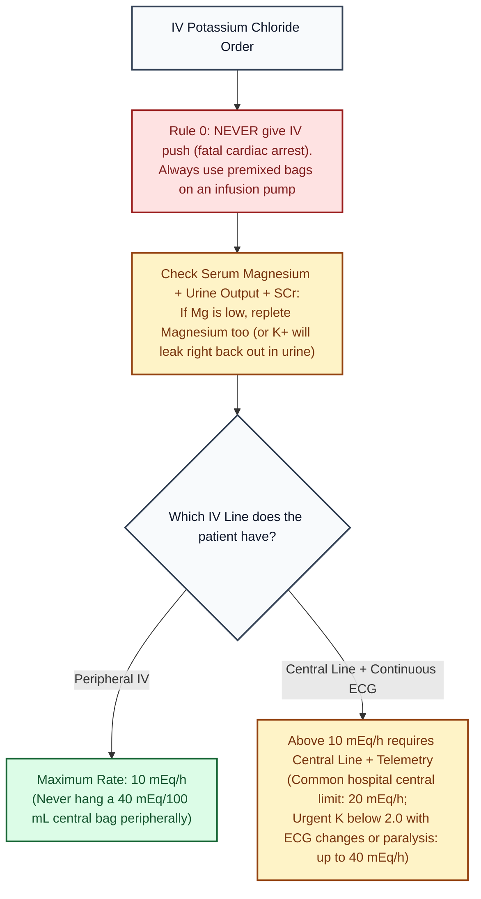

# Potassium Chloride, IV · Drug Monograph

*Drug Monographs section. Built from public sources. Confirm against St. Mary's electrolyte replacement protocol.*
**Key:** ✅✅ two independent sources · ✅ one source · ⚠️ [VERIFY]

ISMP High Alert Medication (concentrated potassium). **Never give IV push.** Use premixed bags; concentrated vials are kept out of patient care areas per ISMP practice ⚠️ [VERIFY St. Mary's storage policy].

## Rates and limits
| Item | Limit | Check | Sources |
|---|---|---|---|
| Usual maximum rate | 10 mEq/h (serum K above 2.5) | ✅✅ | [1] label; [2] StatPearls |
| Above 10 mEq/h | Central line with continuous cardiac monitoring | ✅✅ | [1][2] |
| Urgent (K below 2.0 with ECG changes or paralysis) | Up to 40 mEq/h with continuous ECG and frequent K checks | ✅ | [1] |
| Usual maximum per 24 h | 200 mEq (400 mEq urgent, monitored) | ✅ | [1] |
| 40 mEq/100 mL (400 mEq/L) bag | Central line only | ✅ | [1] |
| Common hospital central rate limit | 20 mEq/h | ⚠️ | [VERIFY St. Mary's policy] |

- About 20 mEq IV raises serum K by roughly 0.25 mEq/L ✅ [2].
- Use only with a calibrated infusion pump; confirm catheter placement ✅ [1].
- Extravasation causes severe tissue injury ✅ [1].
- Check magnesium too: low magnesium makes hypokalemia hard to correct ✅✅ [WikEM: hypokalemia](https://wikem.org/wiki/Hypokalemia); [Huang and Kuo, JASN 2007: hypokalemia in magnesium deficiency](https://nutrition-evidence.com/article/104974/mechanism-of-hypokalemia-in-magnesium-deficiency).

## Visual decision ladder: IV Potassium Chloride line, rate, and magnesium check

*Sources: Potassium Chloride Injection FDA label (2019) [1]; StatPearls (2023) [2]; Huang and Kuo JASN 2007.*

## Plain English memory guide: Mechanism, body timing, and "why never"

| Concept | Plain English picture | Clinical rule on shift |
|---|---|---|
| **How it works (Mechanism)** | **98% of the body's potassium lives inside the cells**, and only **2% floats in the bloodstream**. That tiny 2% sets the electrical resting voltage of the heart muscle. **Why Magnesium matters:** Magnesium acts as the "plug" in the kidney's distal tubule potassium channels (`ROMK`). Without magnesium, the kidney drain stays wide open and every bag of potassium you infuse pours straight into the urine. | Always check and replace **magnesium** alongside potassium in hypokalemic patients ✅ [Huang and Kuo 2007]. |
| **How long it takes in the body (Body Timing)** | • **Expected rise:** Every **20 mEq of IV KCl raises serum K+ by roughly 0.25 mEq/L** (so 40 mEq raises K+ by about 0.4 to 0.5 mEq/L if kidneys and acid base are stable) ✅ [2]. • **Infusion duration:** Because peripheral veins max out at **10 mEq/h**, a 40 mEq total replacement takes **4 hours** peripherally ✅ [1][2]. | Do not recheck a serum potassium level 5 minutes after the bag finishes; allow equilibration and make sure the nurse does not draw the lab upstream from the arm infusing potassium. |
| **Why NEVER give IV push, and why NEVER run >10 mEq/h in a peripheral vein** | • **Why IV push is fatal:** Pushing concentrated KCl hits the heart all at once before it can enter cells, erasing the heart's electrical gradient and stopping the heart in diastole (that is literally how lethal injection works) ✅ [1]. • **Why peripheral veins burn above 10 mEq/h:** Potassium is a strong chemical irritant (`caustic/vesicant` at high concentrations); running `> 10 mEq/h` or `40 mEq/100 mL` in a small hand/arm vein burns the vein wall and causes severe tissue necrosis if it extravasates ✅ [1]. | **Peripheral max = 10 mEq/h.** Anything faster than `10 mEq/h` or concentrated `40 mEq/100 mL` bags **must** go through a **central line with continuous telemetry** ✅ [1][2]. |

## Pharmacist checklist
1. Rate at or below 10 mEq/h peripherally.
2. Central line and telemetry for anything faster.
3. Renal function and urine output before repleting.
4. Not running with other potassium sources (TPN, maintenance fluids) without a total count.
5. DKA: K below 3.5 means potassium first, insulin held ([[Insulin_IV_DKA]]).

## Sources
1. [FDA label, Potassium Chloride Injection (highly concentrated, 2019)](https://www.accessdata.fda.gov/drugsatfda_docs/label/2019/019904s020lbl.pdf)
2. McMahon RS, Bashir K. [Potassium Chloride. StatPearls (updated May 2023)](https://www.ncbi.nlm.nih.gov/sites/books/NBK557785/)

*Last verified: 2026-10-17.*
