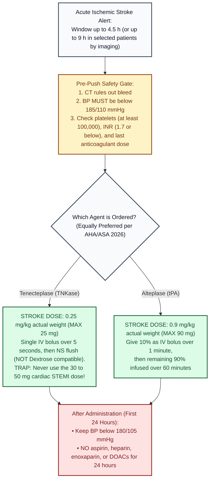

# Tenecteplase and Alteplase (acute ischemic stroke) · Drug Monograph

*Drug Monographs section. Built from public sources. Confirm against St. Mary's stroke alert order set.*
**Key:** ✅✅ two independent sources · ✅ one source · ⚠️ [VERIFY]

ISMP High Alert Medication (thrombolytics). Look alike names and packaging: **alteplase vs tenecteplase**, and **stroke dose vs cardiac dose**.

## Dosing
| Agent | Stroke dose | Check | Sources |
|---|---|---|---|
| **Tenecteplase** | **0.25 mg/kg actual body weight, max 25 mg**, single IV bolus over 5 seconds, then NS flush (not dextrose compatible) | ✅✅ | [1] SUNY Downstate pharmacy update 2025; [2] AHA/ASA 2026 summary; FDA approval for stroke March 2025 [3] |
| Tenecteplase cardiac (STEMI) bands, for contrast | under 60 kg 30 mg; 60 to 69 kg 35 mg; 70 to 79 kg 40 mg; 80 to 89 kg 45 mg; 90 kg or more 50 mg | ✅ | [1] |
| **Alteplase** | **0.9 mg/kg, max 90 mg**: 10% bolus over 1 minute, the rest over 60 minutes | ✅✅ | [1]; [4] Stroke module sources |

2026 AHA/ASA guideline: tenecteplase is **equally preferred** to alteplase; window up to 4.5 h, or up to 9 h in selected patients by imaging ✅✅ [2][5].

## Key contraindications (bleeding risk)
Prior or current intracranial hemorrhage; ischemic stroke, head trauma or intracranial surgery within 3 months; SAH; GI bleed or GI cancer within 21 days; aortic dissection; endocarditis; platelets below 100,000; INR above 1.7; treatment dose enoxaparin within 24 h; recent DOAC; heparin with aPTT above 40 s ✅ [1]. (Full list: St. Mary's order set.)

## Around the dose
- BP below 185/110 before; below 180/105 for 24 h after ✅ (see [[Stroke_Core]]).
- No antithrombotics for 24 h after.
- Angioedema and bleeding management: see [[Stroke_Core]].

## Visual decision ladder: Acute Ischemic Stroke Tenecteplase vs Alteplase (AHA/ASA 2026)

*Sources: SUNY Downstate 2025 [1]; AHA/ASA 2026 summary [2][5]; FDA stroke approval March 2025 [3]; [[Stroke_Core]] [4].*

## Plain English memory guide: Mechanism, body timing, and "why never"

| Concept | Plain English picture | Clinical rule on shift |
|---|---|---|
| **How it works (Mechanism)** | A stroke clot is held together by a tight net of **fibrin threads**. Both **tenecteplase** and **alteplase** bind to fibrin inside the clot and turn **plasminogen** into **plasmin** (molecular scissors that cut the fibrin net apart). **Why Tenecteplase is a 5 second push:** Tenecteplase was bioengineered at 3 spots (`T-N-K`) so it locks onto fibrin more tightly and resists breakdown (`PAI-1`), giving it a longer half life that works as a **single 5 second IV push** instead of a 1 hour drip. | In the 2026 AHA/ASA guidelines, **tenecteplase (`0.25 mg/kg`, max `25 mg`) is equally preferred to alteplase (`0.9 mg/kg`, max `90 mg`)** ✅ [2][5]. |
| **How long it takes in the body (Body Timing)** | • **Alteplase plasma half life:** About **5 minutes** (which is why 90% of the dose must be infused continuously over **60 minutes**) ✅ [1]. • **Tenecteplase plasma half life:** About **20 to 24 minutes** (which allows a single **5 second IV push**) ✅ [1]. • **Fibrinogen depletion window:** Lasts up to **24 hours** (which is why all blood thinners and aspirin are held for **24 hours** after the dose) ✅ [1][4]. | Document the exact bolus time and ensure **no antithrombotics** (no aspirin, heparin, or enoxaparin) are ordered for the next **24 hours** until the repeat head CT clears ✅ [1][4]. |
| **Why NEVER use the 50 mg STEMI vial without wasting excess, and why NEVER mix Tenecteplase with Dextrose** | • **Stroke max is 25 mg (half the cardiac max of 50 mg):** Pushing a 40 or 50 mg cardiac STEMI dose into a stroke patient's fragile brain vessels causes fatal intracranial hemorrhage ✅ [1]. • **Never flush Tenecteplase with Dextrose (`D5W`):** Tenecteplase **precipitates (turns cloudy)** on contact with dextrose lines; always flush the line with **0.9% Normal Saline (`NS`)** before and after the push ✅ [1]. | Draw up **only the calculated stroke dose (`0.25 mg/kg`, max `25 mg`)** into the syringe, waste the remainder of the vial before handing it to the nurse, and flush with **NS only** ✅ [1]. |

## Pharmacist checklist
1. Which agent? Read the vial name twice.
2. Weight: measured or estimated; stroke dose, not cardiac.
3. Tenecteplase: draw up only the stroke dose and discard the rest per policy.
4. Anticoagulant history and last dose time.
5. Document bolus time.

## Sources
1. [SUNY Downstate: Tenecteplase education, pharmacy update (Dec 2025)](https://www.downstate.edu/education-training/fellowship-residency-programs/pharmacy/tenecteplase-education-pharmacy-update-dec-2025.pdf)
2. [HelixTalk 196: 2026 acute ischemic stroke guidelines review](https://www.rosalindfranklin.edu/academics/college-of-pharmacy/helixtalk/helixtalk-196-stretching-the-stroke-clock-to-2026-a-brief-review-of-the-2026-acute-ischemic-stroke-guidelines/)
3. [HCPLive: FDA approves tenecteplase for acute ischemic stroke (March 4, 2025)](https://www.hcplive.com/view/fda-approves-tenecteplase-tnkase-for-acute-ischemic-stroke)
4. [[Stroke_Core]] source list
5. [JournalFeed: 2026 stroke guidelines and updates](https://journalfeed.org/article-a-day/2026/new-2026-stroke-guidelines-and-updates/)

*Last verified: 2026-10-17.*
