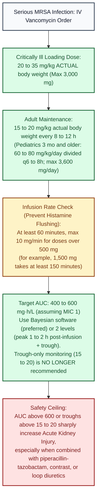

# Vancomycin (IV) · Drug Monograph

*Drug Monographs section. Built from public sources. Confirm against St. Mary's pharmacy to dose protocol and its dosing software.*
**Key:** ✅✅ two independent sources · ✅ one source · ⚠️ [VERIFY]

## Dosing and monitoring (2020 ASHP/IDSA/PIDS/SIDP consensus, serious MRSA)
| Item | Recommendation | Check | Sources |
|---|---|---|---|
| Target | AUC 400 to 600 mg·h/L (assuming MIC 1) | ✅✅ | [1][2] |
| Trough only monitoring | Not recommended | ✅✅ | [1][2] |
| How to get AUC | Bayesian software (preferred) or two levels (one 1 to 2 h after infusion, one trough) | ✅✅ | [1][2] |
| Loading dose (critically ill) | 20 to 35 mg/kg actual body weight, max 3,000 mg | ✅✅ | [1][2] |
| Pediatrics 3 months to 12 years | 60 to 80 mg/kg/day divided every 6 h; same AUC target | ✅ | [1] |
| Pediatrics 12 years and older | 60 to 70 mg/kg/day divided every 6 to 8 h | ✅ | [1] |
| Pediatric empiric max | 3,600 mg/day (normal kidneys) | ✅ | [1] |
| Maintenance (adults) | 15 to 20 mg/kg actual body weight every 8 to 12 h, then adjust to AUC; children 3 months and older 60 to 80 mg/kg/day divided q6 to 8h | ✅✅ | [Consultant360: 2020 vancomycin guideline](https://consultant360.com/infectious-diseases/bacterial-infections/updated-consensus-guidelines-vancomycin-monitoring); [US Pharmacist: optimizing vancomycin (2023)](https://uspharmacist.com/article/optimizing-vancomycin-efficacy-and-reducing-nephrotoxicity-1) |
| Neonates | AUC guided where possible; use the neonatal dosing reference | ⚠️ | see [[NICU_Core]] |

## Safety
- Higher AUC (above 600) and troughs above 15 to 20 raise acute kidney injury risk; watch with piperacillin tazobactam, contrast, loop diuretics ⚠️ [VERIFY second source].
- **Vancomycin infusion reaction** (formerly "red man syndrome"): slow the infusion (at least 60 minutes, max 10 mg/min for doses over 500 mg; 90 to 120 min after a prior reaction); antihistamine. It's not a true allergy ✅ [RCH Melbourne: vancomycin IV guideline](https://pig.rch.org.au/pages/vancomycin).

## Visual decision ladder: Vancomycin 2020 AUC guided dosing and infusion rate

*Sources: 2020 ASHP/IDSA/PIDS/SIDP Vancomycin Consensus Guideline (Rybak et al. 2020) [1][2]; RCH Melbourne IV guideline.*

## Plain English memory guide: Mechanism, body timing, and "why never"

| Concept | Plain English picture | Clinical rule on shift |
|---|---|---|
| **How it works (Mechanism)** | Bacteria build their cell wall out of bricks that end in two little hooks (`D-Ala-D-Ala`). Whereas beta lactams break the *trowel* (`PBP` enzyme) that lays the bricks, **vancomycin is a giant steel cap that snaps directly over the `D-Ala-D-Ala` bricks themselves** so MRSA cannot glue its wall together. Because vancomycin is a huge molecule, it cannot squeeze through the outer membrane of Gram negative bacteria (**Gram positive only**). | Vancomycin kills **slowly** and depends on total **24 hour exposure (`AUC/MIC` target 400 to 600)** rather than a single high peak ✅ [1][2]. |
| **How long it takes in the body (Body Timing)** | • **Loading dose (`20 to 35 mg/kg` actual weight, max `3,000 mg`):** Fills the patient's fluid volume (`Vd`) on Day 1 so critically ill patients don't wait 24 to 36 hours to reach therapeutic levels ✅ [1][2]. • **Elimination:** Cleared **>80 to 90% unchanged by the kidneys**. | Why the 2020 guideline dropped trough only (`15 to 20 mcg/mL`) monitoring: many patients hit an **AUC of 400 to 600** at a trough of only `11 or 12 mcg/mL`; pushing their trough to `18 mcg/mL` gave them an AUC over `700` and injured their kidneys ✅ [1][2]. |
| **Why NEVER infuse faster than 10 mg/min, and why IV vancomycin NEVER treats C. diff** | • **Why fast infusions cause flushing ("Vancomycin Infusion Reaction"):** Infusing faster than `10 mg/min` directly pokes mast cells in the skin to dump histamine (bright red neck/chest and itching). It is a **rate reaction, NOT a true IgE allergy** ✅ [RCH Melbourne]. • **Why IV vancomycin fails in C. diff:** Vancomycin is too large to cross from the bloodstream into the colon lumen (and oral vancomycin stays in the gut and never reaches the blood for pneumonia/bacteremia; see [[ID_Core]]). | Infuse at **max 10 mg/min** (at least `60 min` up to `1,000 mg`, `90 min` for `1,500 mg`, `120 min` for `2,000 mg`); if flushing occurs, pause, give diphenhydramine, and restart slower over 90 to 120 minutes ✅. |

## Pharmacist checklist
1. Indication and whether a loading dose is needed.
2. Actual body weight; SCr trend; urine output.
3. Level plan (Bayesian or two levels), not trough only.
4. Nephrotoxic combinations.
5. Infusion time matches dose.

## Sources
1. [Pharmacy Times: New guidelines released for monitoring vancomycin in serious MRSA infections](https://pharmacytimes.com/news/new-guidelines-released-for-monitoring-vancomycin-in-serious-mrsa-infections) (summarizes Rybak MJ, et al. Am J Health Syst Pharm. 2020;77(11):835-864)
2. [PMC record of the 2020 consensus guideline](https://pmc.ncbi.nlm.nih.gov/articles/PMC8034673) (PubMed's bot check blocked the full text; open it directly to confirm)

*Last verified: 2026-10-17.*
